# WRO Future Engineers 2026 — Flawil Beavers

We are **Damian Hardegger** and **Philipp Kündig** from Flawil, Switzerland, coached by **Stefan Gemperli**. We designed and built a four-wheel autonomous car for the WRO 2026 Future Engineers World Final.

> **[Quick build and run guide](docs/guides/QUICK_BUILD_AND_FIRST_RUN.md).** Rebuild our robot in nine steps, from the parts list and print files to wiring, firmware upload and your first autonomous run.

**Current firmware** · [Browse the source on `main`](https://github.com/flawil-beavers/Future-Engineers_2026/tree/main)

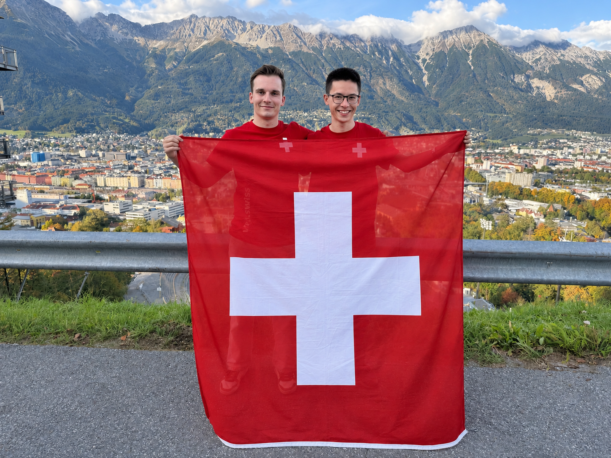

## Contents

- [Bill of Materials (BOM)](#bill-of-materials-bom)
- [Assembly](#assembly)
- [Mobility and Mechanical Design](#mobility-and-mechanical-design)
- [Power and Sensor Architecture](#power-and-sensor-architecture)
- [Software Architecture and Challenge Strategy](#software-architecture-and-challenge-strategy)
- [Systems Integration and Validation](#systems-integration-and-validation)
- [Build, Upload and Reproduction](#build-upload-and-reproduction)
- [Video](#video)
- [Robot Photos](#robot-photos)
- [AI Use Declaration](#ai-use-declaration)

Find simulation tools, test evidence and competition references in the [repository guide](docs/README.md).

## Bill of Materials (BOM)

| Component | Quantity | Function | Estimated CHF |
| --- | ---: | --- | ---: |
| Arduino GIGA R1 WiFi | 1 | M7 motion and vision, M4 rear distance sensor | 60.90 |
| Adafruit BNO085 | 1 | IMU for heading relative to the starting orientation | 24.95 |
| Adafruit VL53L4CX | 3 | Left, right and rear time-of-flight ranging | 59.70 |
| Qwiic/STEMMA QT cables | 2 | Cut into pigtails for direct ToF-to-GIGA wiring | 23.10 |
| Arducam B0462 camera (GC2145) | 1 | On-board traffic-sign vision | ~30.00 |
| Pololu Dual MC33926 motor driver | 1 | Bidirectional drive control | ~25.00 |
| Adjustable Mini-360 DC-DC step-down module | 1 | Voltage regulation | ~2.00 |
| Generic 3.3 V to 5 V logic-level shifter | 1 | Signal-level translation | ~3.00 |
| BerryBase SVM330-Y | 1 | Two-wire yellow LED voltage display, 0.28 in, 3.2–30 V | ~5.00 |
| Generic 10 × 15 mm rocker switch | 1 | Main battery power (SW2) | ~0.20 |
| MTS-102 ON–ON toggle switch | 1 | Physical start/enable (SW1) | 3.80 |
| DFRobot 6 V encoder gearmotor, 30:1 | 1 | Rear-axle propulsion | 13.90 |
| TowerPro MG90S servo | 1 | Front steering linkage | 7.90 |
| 14500 Li-ion cells, 3.7 V and 750 mAh each | 4 total, 2 installed | One 2S pack on the robot and one spare pair | 31.60 |
| 3D-printed chassis and all custom CAD parts, including mounts and battery holders | 1 set, 2 holders | Supports and locates the mechanical and electronic assemblies | ~10.00 |
| LEGO wheels, axles, gears and mounting pieces | 4 wheels, other parts as required | Attaches the wheels to the chassis and transmits drive to the rear wheels. Drive wheels are 43.2 mm in diameter. | |
| Metal coupling shaft | 1 | Connects the DC motor to the LEGO drive axle | |
| Metal screws and nuts (M3, M2.5 and M2), including some nuts with rubber inserts and springs and washers | As required | Fastens chassis parts and mounts | ~10.00 |
| Wiring harness (cables, WAGOs, screw to cable connectors, etc.) | 1 | Power distribution | |
| **Total for priced items** | | **Recorded project estimates** | **311.05** |

The CHF 10 fastener estimate covers the hardware used. We bought only a small quantity for this build.

## Assembly

### CAD and 3D printing

**Version 74 is the current CAD model, including the rear ToF mount.** The editable design, printable project and prepared job serve different stages of reproduction. The [CAD guide](CAD/README.md) also documents how to extract and check the steering geometry.

| Artifact | How to use it |
| --- | --- |
| [PrusaSlicer project](CAD/Car_v74.3mf) | Open as a project to load all 17 meshes with their arrangement and settings. Select your printer, nozzle and material profiles, then slice and inspect the preview. |
| [Autodesk Fusion archive](CAD/Car_v74.f3z) | Import the editable assembly and its linked design to inspect mount positions or export revised meshes. |
| [Prepared binary G-code](CAD/printing/Car_v74_0.4n_0.2mm_PLA_MK4IS_3h1m.bgcode) | Use with the Original Prusa MK4 Input Shaper, 0.4 mm nozzle and PLA configuration for which it was generated. |

| Plate arrangement | Toolpath preview |
| --- | --- |
| 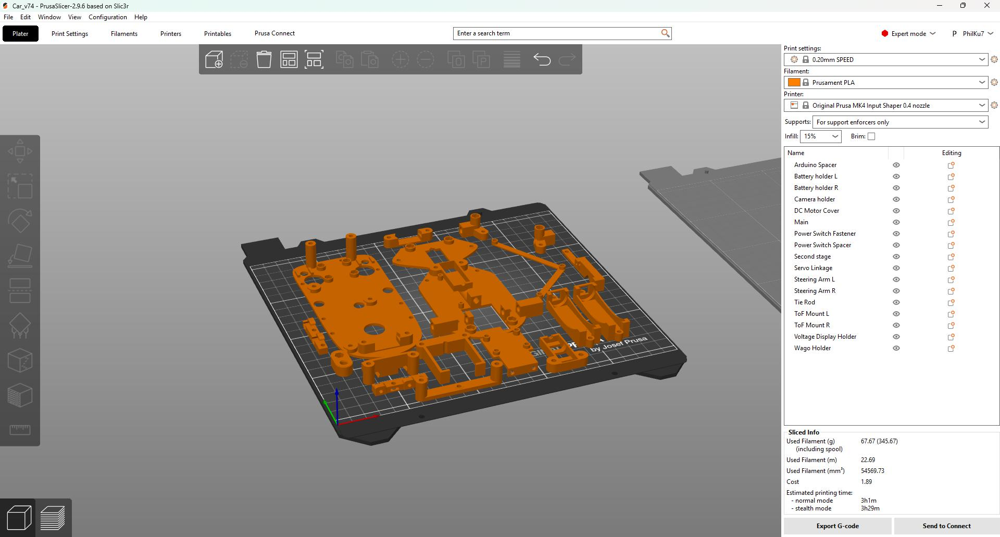 |  |

All 17 parts fit on one build plate. We print in PLA with 0.2 mm layers and 15% infill. Use the orientations saved in the PrusaSlicer project so every part prints without supports. We recommend printing one part at a time to reduce stringing and surface defects caused by travel between parts.

We initially chose PETG for its strength. When the filament absorbed moisture, we saw heavy stringing in our prints. We switched to PLA after our trials showed that it worked well for the robot parts and produced less stringing.

### Mechanical assembly

Use M3 screws and M3nS/M3n nuts for the structural parts. Use M2 or M2.5 screws with matching nuts for electronic modules. Build the lower stage first to retain access to the drive, steering and battery holders. Then fit the sensor mounts and controller, route the harness through the upper stage and join the stages. The [v74 assembly](CAD/Car_v74.f3z) shows the rear sensor mount.

The photographs illustrate the original two-stage assembly sequence.

| Assembly steps | | |
| --- | --- | --- |
|  <br> Prepare all the printed parts. | 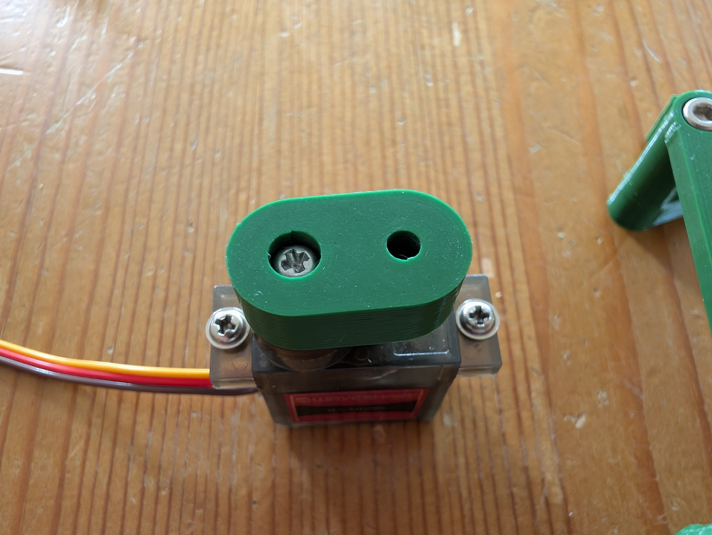 <br> Screw the linkage onto the servo. |  <br> Connect the tie rod to both steering arms with M3n nylon lock nuts. |
| 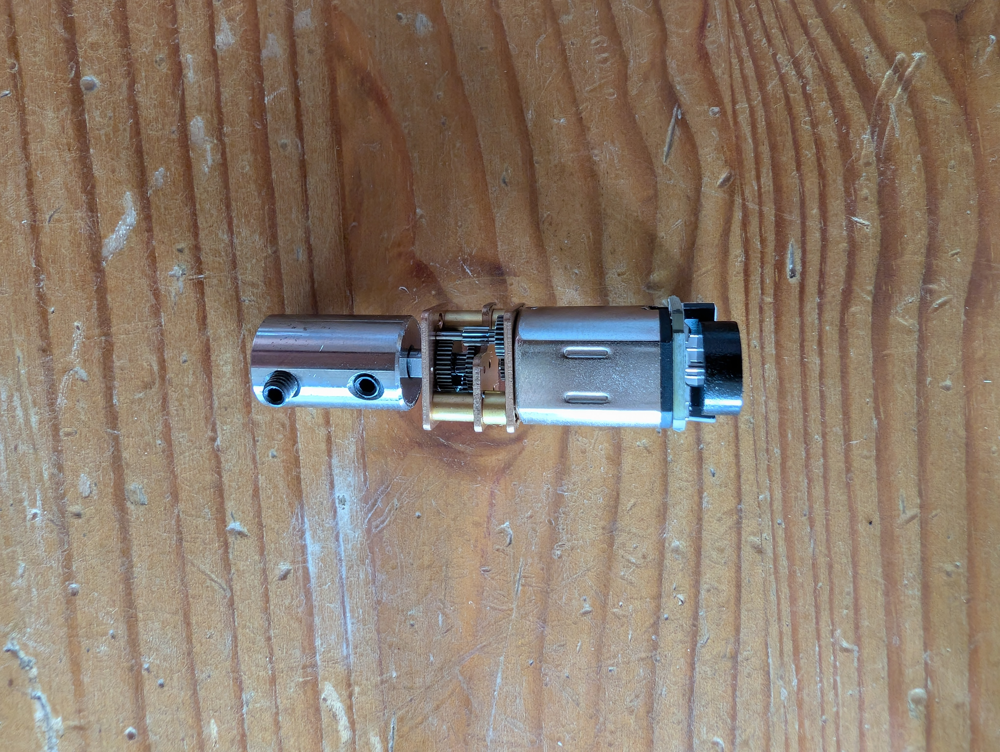 <br> Fit the drive coupling to the motor shaft. |  <br> Fasten the DC motor to the lower stage with its cover and screw the servo in place. | 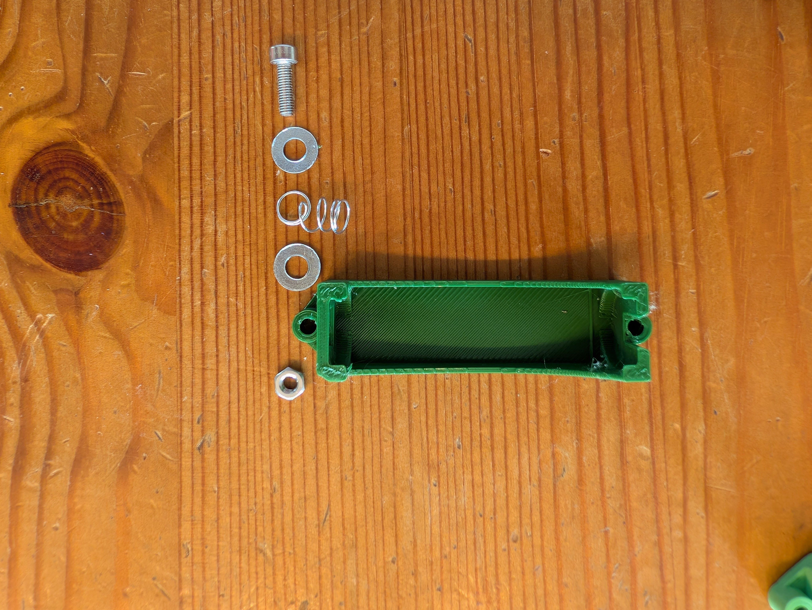 <br> Prepare both battery holders. |
|  <br> Screw the battery holders onto the lower stage. | 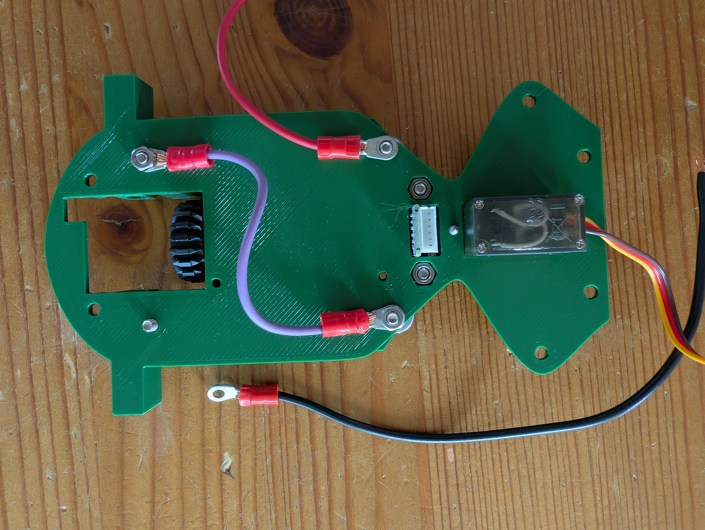 <br> Attach the wires to the protruding screws and secure them with nuts. | 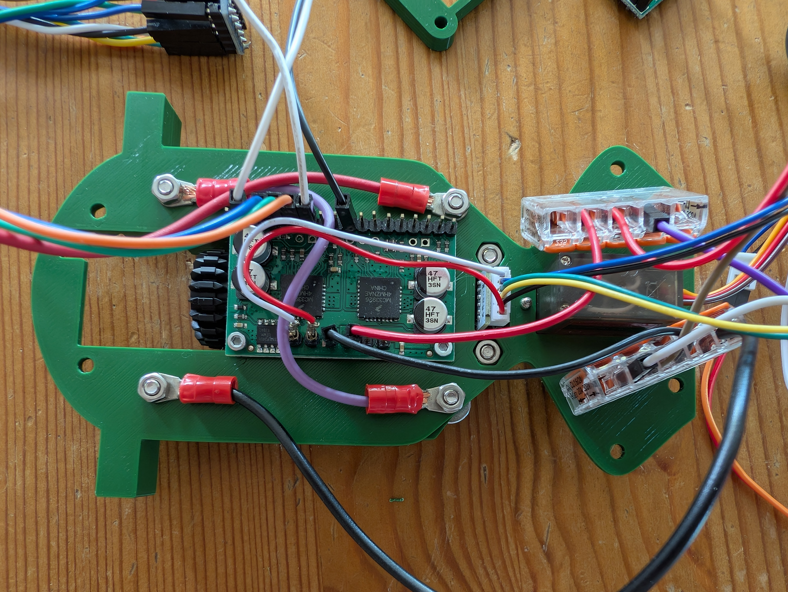 <br> Fit the motor driver with M2 screws and wire it up. Use WAGO connectors for GND and VCC. |
| 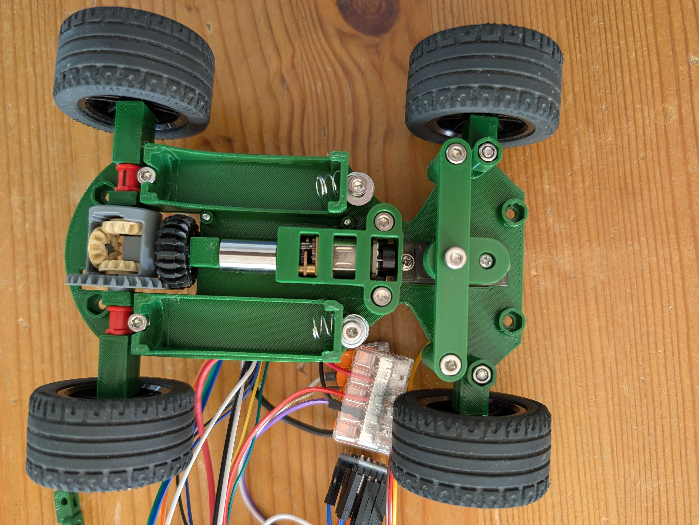 <br> Fit the LEGO gears, axles and wheels. |  <br> Fasten the sensors to the upper stage with M2.5 screws and nuts. This photo shows the earlier ToF-to-BNO085 wiring. See the [current wiring](#wiring-and-signal-interfaces). | 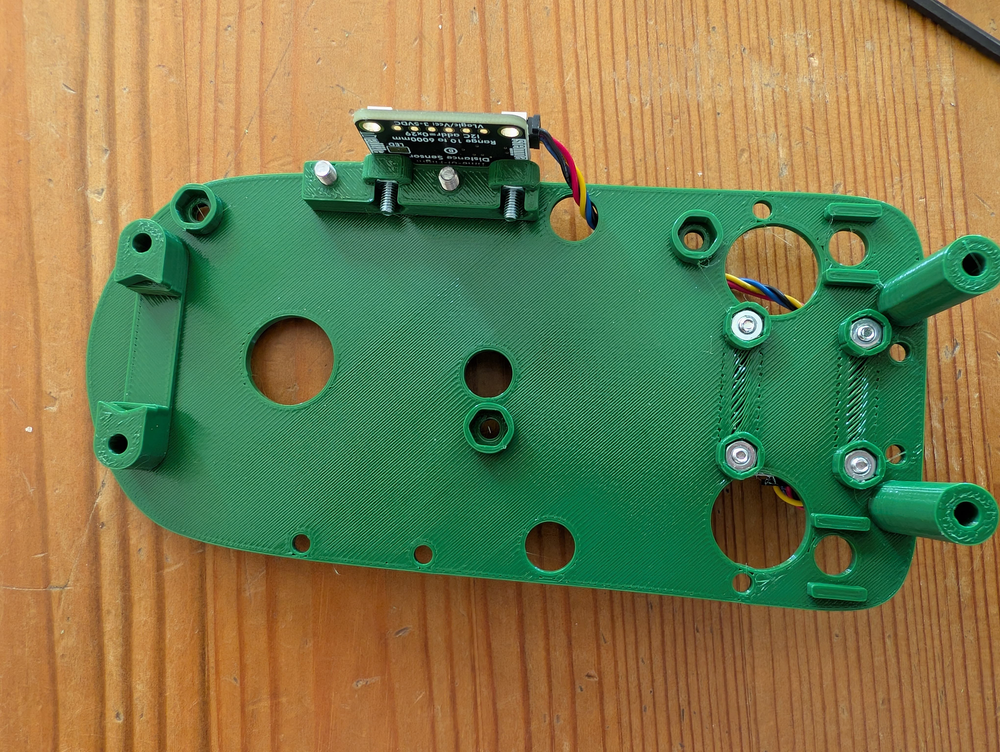 <br> Fasten the ToF mounts with M3 screws. |
|  <br> Place the Arduino GIGA on its spacer and fasten it with M3 screws. | 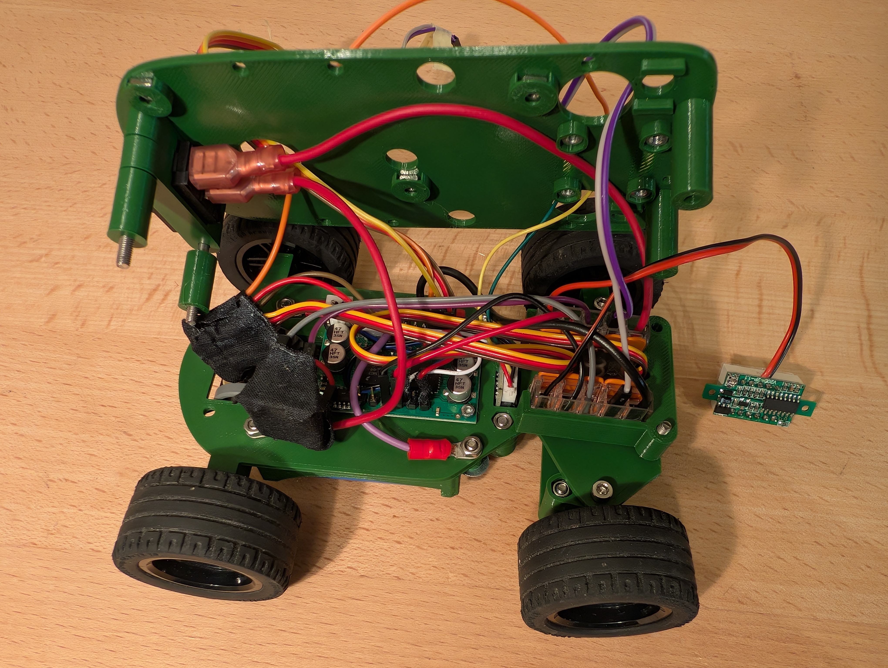 <br> Route the power and signal wiring through the upper stage. | 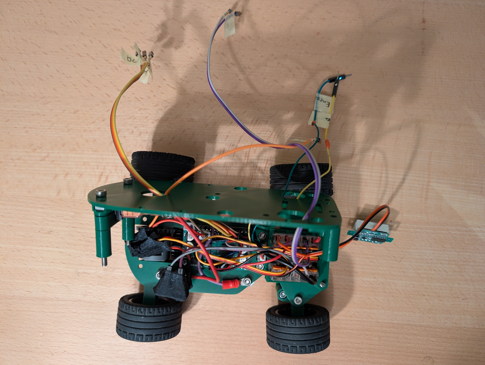 <br> Thread the wires through the upper stage to the GIGA. |
|  <br> Fit the WAGO holder and main power rocker (SW2), then screw the two stages together. | | |

## Mobility and Mechanical Design

### Robot specifications

| Specification | Recorded value |
| --- | ---: |
| Length | 158 mm straight, 170 mm at full lock |
| Width across wheels (straight) | 123 mm |
| Height | 115 mm |
| Wheelbase | 98 mm |
| Drive-wheel diameter | 43.2 mm |
| Mass | 680 g |

See [parking bay sizing](#obstacle-challenge-strategy) for the nominal length.

### Chassis and steering

Our screw-fastened two-stage chassis gives us access to the drivetrain below and the sensors and controller above. The commercial dual-cell holder we first used limited where we could place the batteries and held them tightly, which slowed swaps. We replaced it with two self designed 3D-printed holders mounted low on opposite sides of the chassis. Each cell is accessible from below, and the layout distributes the battery mass across the chassis.

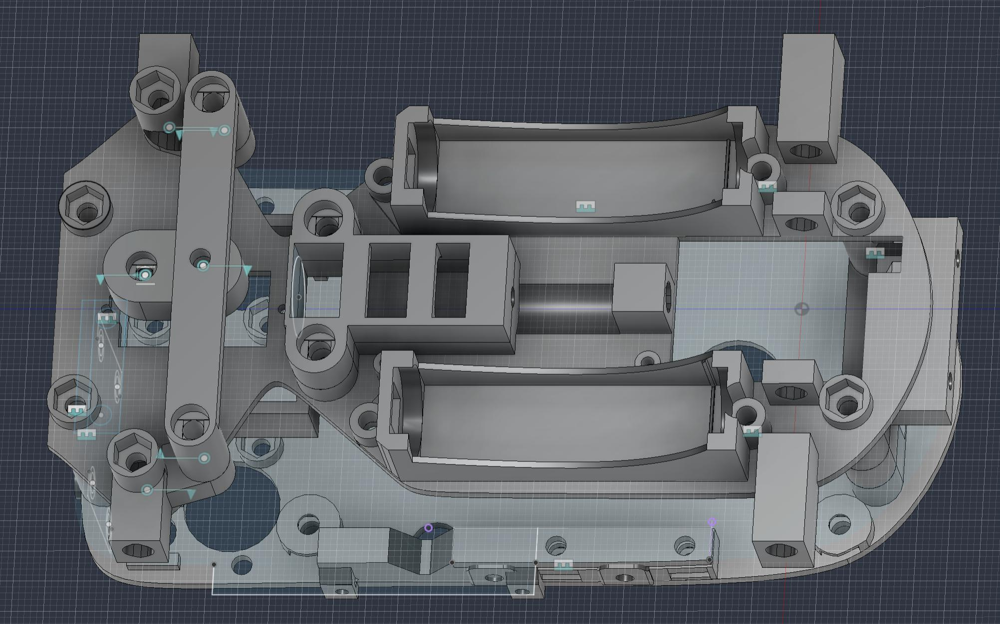


The steering arms are angled toward the centre of the rear axle so the inner front wheel turns more sharply than the outer wheel. This reduces scrub through a corner. The compact linkage trades steering travel for clearance at full lock. The first PDI-1102HB micro servo moved inconsistently under load. The larger MG90S improved repeatability and required more mounting space. We adjusted the mounting heights several times to accommodate different screw lengths and nuts that we had at hand. Therefore, some components connect at different heights now.

We simulated the steering linkage in Fusion 360 and used the inner and outer wheel angles to predict the turning radius. We compared those predictions with radii calculated from encoder travel and BNO085 heading during full-circle tests. The comparison revealed a small offset in the servo's neutral position, which we accounted for in the calibration. The front wheels reach farther forward at full lock, so the parking planner uses the measured footprint with the wheels straight and fully turned to check clearance along the path. [Ackermann calibration and turning-radius comparison](CAD/ACKERMANN_KINEMATICS_DOCUMENTATION.md#turning-radius-comparison) · [Measured parking contour](simulation/reports/RETURNED_651_656_PARKING_20261105.md#measured-geometry-and-implementation)

### Drive selection and low-speed control

We connect the DC motor to the LEGO drivetrain with a custom manufactured metal coupling shaft. Its precise fit kept the connection stable through repeated driving tests. We mounted the motor on the lower chassis stage so we could reach it for maintenance and swap gearmotors easily while comparing gearbox ratios.

Early in the season we tested the 50:1 and 100:1 gearmotors on the robot, comparing acceleration and speed control under load. For the World Final, we prioritised higher driving speed and tuned the new drivetrain for slow manoeuvres.

| Stage and gearbox | Output speed at 6 V, no-load / rated | Rated torque | What we observed and chose |
| --- | ---: | ---: | --- |
| Early comparison · **50:1** | 310 / 180 RPM | 0.35 kgf·cm | The faster of the two early options drove less consistently under load, so we ruled it out. |
| Initial selection · **100:1** | 155 / 90 RPM | 0.70 kgf·cm | We chose the higher reduction for stronger acceleration and more consistent speed control under load. |
| World Final · **30:1** | 530 / 300 RPM | 0.20 kgf·cm | We chose the lower reduction for higher driving speed. The reduced torque multiplication made starting from rest and driving at full lock more demanding at crawl speed. |

The speeds and torques are manufacturer ratings at the gearbox output. The driving observations come from tests on our robot. [DFRobot 50:1 specifications](https://www.dfrobot.com/product-1432.html) · [100:1 specifications](https://www.dfrobot.com/product-1433.html) · [30:1 specifications](https://www.dfrobot.com/product-1431.html)

**Encoder distance.** The encoder measures rotation at the motor shaft. We account for both gear stages to find how many ticks correspond to one turn of the wheel.

| Factor | Where it comes from |
| --- | --- |
| 7 | The Hall encoder produces seven signal cycles per motor-shaft revolution on each channel. |
| 4 | We count the rising and falling edge on each of the two encoder channels, giving four ticks per cycle. |
| 30 | The 30:1 motor gearbox takes 30 motor-shaft turns for one gearbox-output turn. |
| 28/20 | The LEGO differential gear transmission takes 28/20 gearbox-output turns for one wheel turn. |
| 43.2 mm | This is the drive-wheel diameter. Multiplying it by $\pi$ gives the distance covered by one wheel turn. |

We divide the wheel circumference by the ticks per wheel revolution to get $k$, the distance per tick stored as `COUNTER_TO_MM`. Multiplying $k$ by the change in ticks, $\Delta N$, gives the distance travelled.

$$
\begin{aligned}
N_{\mathrm{gear}} &= 7 \times 4 \times 30 = 840 \quad \text{counts per gearbox-output revolution} \\
N_{\mathrm{wheel}} &= N_{\mathrm{gear}} \times \frac{28}{20} = 1{,}176 \quad \text{counts per wheel revolution} \\
k &= \frac{\pi d_{\mathrm{wheel}}}{N_{\mathrm{wheel}}}
   = \frac{\pi \times 43.2\,\mathrm{mm}}{1{,}176\,\text{ticks}}
   \approx 0.1154\,\mathrm{mm/tick} \\
\Delta s &= \Delta N \times k
\end{aligned}
$$

[Encoder ticks to millimetres](include/config.h#L137)

**Low-speed control.** Our original minimum-PWM cutoff switched the motor off at small commands and back on as the robot slowed. The resulting surges shook the chassis. For speed targets up to 120 mm/s and PWM requests below the powered-slot setting, we now use pulse-density modulation. The encoder-based PI loop adjusts the request, and steering feed-forward adds effort to account for tyre scrub in turns.

| Symbol | What it means |
| --- | --- |
| $T_{\mathrm{slot}}$ | Time between on/off decisions, set to 5 ms. |
| $u_{\mathrm{req}}$ | Magnitude of the requested PWM command at the scheduler input. |
| $u_{\mathrm{on}}$ | PWM command during a powered slot, set to 120 on the 0–255 output scale. An unpowered slot uses zero. |
| $N_{\mathrm{slots}}$, $N_{\mathrm{on}}$ | Total slots and powered slots counted over the same interval. |

At each slot, the scheduler adds the requested PWM magnitude to an accumulator. When the sum reaches the powered-slot setting, it powers the slot and subtracts that setting from the accumulator. Over several slots, a steady request produces a powered fraction $p_{\mathrm{on}}$ close to $u_{\mathrm{req}}/u_{\mathrm{on}}$. The slot duration sets the decision rate $f_{\mathrm{slot}}$, and the powered fraction scales the PWM duty within a slot to give the average duty $\bar{D}$.

$$
\begin{aligned}
f_{\mathrm{slot}} &= \frac{1}{T_{\mathrm{slot}}} = \frac{1}{5\,\mathrm{ms}} = 200\,\mathrm{Hz} \\
p_{\mathrm{on}} &= \frac{N_{\mathrm{on}} T_{\mathrm{slot}}}{N_{\mathrm{slots}} T_{\mathrm{slot}}}
                 = \frac{N_{\mathrm{on}}}{N_{\mathrm{slots}}}
                 \approx \frac{u_{\mathrm{req}}}{u_{\mathrm{on}}} \\
\bar{D} &= p_{\mathrm{on}} \times \frac{u_{\mathrm{on}}}{255}
          \approx \frac{u_{\mathrm{req}}}{255}
\end{aligned}
$$

A steady request of 60 PWM units therefore powers about half the slots at 120 PWM units, for an average duty of about 24%.

## Power and Sensor Architecture

### Power budget

Two 14500 Li-ion cells in series give **7.4 V nominal, 8.4 V fully charged and 750 mAh nominal pack capacity**. The main power rocker (SW2) switches the battery supply to the motor driver, the GIGA's VIN and the step-down module that supplies the servo's 5 V rail.

We budgeted for normal driving and simultaneous peak loads. The motor row shows pack current through the PWM bridge. We model the GIGA as an equivalent 3.3 V load, separate from the camera and sensors.

| Load | Supply rail | Average current | Peak current |
| --- | --- | ---: | ---: |
| Drive motor through PWM bridge | 7.4 V pack input | 300 mA | 800 mA |
| MC33926 driver overhead on the pack rail | 7.4 V | 20 mA | 40 mA |
| SVM330-Y voltage display | 7.4 V | 4 mA | 4 mA |
| GIGA board electronics, excluding external loads | 3.3 V equivalent | 200 mA | 300 mA |
| Arducam GC2145 camera | 3.3 V | 120 mA | 150 mA |
| Three VL53L4CX ToF sensors | 3.3 V | 60 mA (3 × 20 mA) | 120 mA (3 × 40 mA) |
| BNO085 IMU | 3.3 V | 15 mA | 20 mA |
| Drive motor encoder | 3.3 V | 5 mA | 10 mA |
| Level shifter low-voltage side and driver logic | 3.3 V | 2 mA | 4 mA |
| MG90S steering servo | 5 V from Mini-360 | 250 mA | 700 mA |
| Level shifter high-voltage side | 5 V from Mini-360 | 1 mA | 2 mA |

The GIGA regulates VIN down to 5 V internally and then steps that rail down to 3.3 V. A regulator's **input current** is what it draws from the rail that feeds it. Its **output current** is what it supplies to the loads on its regulated rail. We assume **90% efficiency per conversion stage**. To calculate input current, we divide output power by input voltage and efficiency $\eta$.

$$
I_{\mathrm{in}} = \frac{V_{\mathrm{out}} I_{\mathrm{out}}}{V_{\mathrm{in}} \eta}
$$

| Regulator | Input rail | Output rail | Input current (average / peak) | Output current (average / peak) |
| --- | --- | --- | ---: | ---: |
| GIGA 3.3 V regulator | GIGA internal 5 V rail | GIGA 3.3 V | 295 / 443 mA | 402 / 604 mA |
| GIGA internal 5 V regulator | 7.4 V pack via VIN | GIGA internal 5 V | 221 / 333 mA | 295 / 443 mA |
| Mini-360 servo regulator | 7.4 V pack | Servo 5 V | 188 / 527 mA | 251 / 702 mA |

For example, supplying an average of 251 mA to the Mini-360's 5 V loads takes about 188 mA from the 7.4 V pack. The GIGA's 3.3 V regulator draws from the internal 5 V rail, so its current is already included in the GIGA VIN budget. The battery total adds the direct pack loads and the input currents of the two regulators fed from the pack.

| Pack load at 7.4 V nominal | Average current | Peak current |
| --- | ---: | ---: |
| Motor, driver pack overhead and display | 324 mA | 844 mA |
| GIGA branch, including camera and sensors | 221 mA | 333 mA |
| Mini-360 branch, including servo and level shifter | 188 mA | 527 mA |
| **Total pack current** | **≈0.73 A** | **≈1.70 A** |

We measured pack current over **5 s per test**. It averaged about **0.75 A at idle** and **1.35 A with the drive wheels spinning off the ground**. Idle draw was already close to the **0.73 A** normal-driving budget, and running the drivetrain on the bench added about **0.60 A**. Tyre load on the track can raise the draw, and the five-second averages smooth out brief current spikes.

The peak budget calls for about **0.70 A** from the Mini-360. Regulator headroom depends on how it behaves under steering load. Acceleration can lower the shared pack voltage at the GIGA. Arduino specifies **6 V minimum at VIN**, so the voltage under load matters when assessing the pack.

### Wiring and signal interfaces

[](img/diagrams/Wiring_Diagram_FE2026_v1.png)

| Function | Interface |
| --- | --- |
| Drive motor and encoder | Motor driver channel M2, direction D5/D6 and PWM D7. Encoder A on D3 and B on D2. |
| Steering servo signal | D4 |
| BNO085 IMU | `SPI1` with chip select D10, interrupt A0 and reset A1 |
| Left VL53L4CX | M7 hardware I²C (`Wire`), SDA D20 and SCL D21 |
| Right VL53L4CX | M7 hardware I²C (`Wire2`), SDA D9 and SCL D8 |
| Rear VL53L4CX | M4 software I²C at 100 kHz, SDA A3 and SCL A4 |
| Arducam B0462 (GC2145) | 20-pin GIGA camera connector, DCMI pixel input and I²C configuration |
| Main power rocker (SW2) | Switches the positive battery lead |
| Physical start/enable toggle (SW1) | A2, active HIGH |
| Rear measurement transfer | On-chip OpenAMP/RPC, fixed-size frames with sequence and status |

[Main pin assignments](include/config.h#L99-L128) · [Rear ToF pins](src/m4/rear_tof_m4.cpp#L10-L17)

#### Sensor wiring choices

**Choice of ToF module.** We replaced the VL53L3CX with the VL53L4CX for its longer rated range and the plug-in connectors on the Adafruit breakout. ST lists up to 6 m for the VL53L4CX and 3 m for the VL53L3CX under reference conditions. We wanted more range for initial wall discovery and set shorter limits in firmware for normal driving. We also damaged a VL53L3CX module by accidentally soldering individual wires together. The STEMMA QT/Qwiic connectors make it easier to replace a sensor without soldering at the board. [VL53L3CX specifications](https://www.st.com/en/imaging-and-photonics-solutions/vl53l3cx.html) · [VL53L4CX specifications](https://www.st.com/en/imaging-and-photonics-solutions/VL53L4CX)

**Separate ToF buses.** Each VL53L4CX starts at the same I²C address (0x29), so daisy-chaining caused an address conflict. To assign different addresses at startup, we would have needed extra soldered wires to the XSHUT pins so we could bring up one sensor at a time. We gave each ToF its own I²C bus. [VL53L4CX breakout pinout](https://learn.adafruit.com/adafruit-vl53l4cx-time-of-flight-distance-sensor/pinouts)

**Connections to the GIGA.** We cut four-pin STEMMA QT/Qwiic cables in half. Each connector plugs into a ToF sensor, and jumper wires carry power, ground, SDA and SCL from the cut end to the GIGA's pin headers.

**IMU on SPI.** We tested the BNO085 on the shared I²C bus and observed unreliable IMU readings during frequent ToF transactions. We moved the BNO085 to SPI, with its own jumper wires to the GIGA.

### Sensor placement

| Sensor | Why we mounted it there |
| --- | --- |
| Left and right ToF sensors | We found space on both sides of the chassis at about half the wall height. That gave us room for the mounts and cables while keeping the wheels clear. The sensors face left and right so we can follow the wall in either driving direction. |
| Rear ToF sensor | We aimed it at the magenta marker behind the parked car. Its reading lets us check the starting clearance before the car exits the bay. [Parked start](#obstacle-challenge-strategy) |
| Camera | We tried a forward-facing position so the camera could see upcoming pillars. It gave us a clear view in our tests, so we kept that position. |
| BNO085 IMU | We mounted it level with the floor and aligned it with the chassis so its axes match the robot's directions. This makes the heading measurements easier to interpret. |

### Heading and distance sensing

**Heading.** The BNO085 supplies a **100 Hz game rotation vector**. Its yaw uses fused gyro and accelerometer data. A magnetometer reference gave unstable heading in the vehicle, where the driving motors and wiring were possible sources of interference. The filter uses no magnetic reference. In the Open Challenge, we use the car's heading at the start as the reference for the course. The encoder supplies travel for the position estimate.

**Black-wall ranging.** The black walls absorbed much of the infrared light, leaving too few photons returning to the sensors for reliable longer-range readings. We therefore limit the ranges accepted during normal wall following to **600 mm**, with a **30 ms** measurement budget. Initial direction discovery in Open uses **300 ms** to collect more return light, then restores 30 ms once the followed side is confirmed. The control filter checks measurement status, signal strength and uncertainty and caps changes between consecutive valid in-range readings at **100 mm**. Out-of-range transitions bypass that cap.

**Wall-edge timing.** ST measured a full diagonal opening angle of **22° at 100 mm** and **18° at 1 m**. The cone can still see a wall after the sensor passes its edge, so we also use encoder travel and heading to detect corners. [VL53L4CX datasheet](https://www.st.com/resource/en/datasheet/vl53l4cx.pdf#page=26)

### Camera and calibration

We use a wide **1616 × 1208** window on the Arducam GC2145 and reduce it to **320 × 240** for processing. The camera sees about **65° from left to right**, so it can pick up signs near the sides of the track that our earlier centre crop could miss. The software looks for red and green signs. [Colour-region detection](src/vision.cpp#L746-L780)

Arducam's **80° (D)** specification measures the view from one corner of the image to the opposite corner. On a 4:3 image, a simple lens model converts an 80° diagonal view to about **68° across the width**. We use the horizontal angle from our own calibration to estimate where signs are to the left or right of the car. [Arducam camera specifications](https://docs.arducam.com/DVP-Camera-Module/Arduino-GIGA/Arduino-GIGA/Introduction/)

**Distance and height calibration.** With the camera installed, we placed signs of known heights at measured distances from the lens. We used the point where the base meets the mat in the image to calibrate the distance estimate. When both the top and the base are visible, the software also estimates the sign's height. We checked the revised estimates against the known distances and heights in stationary images of both colours. [Camera calibration report](simulation/reports/SURPRISE_RULE_MEASURED_VALIDATION_20261119.md#image-measurements)

The original driver held the main loop for roughly **149 ms** while it captured and processed each frame. We switched to continuous capture with two frame buffers in external SDRAM. The camera interface (DCMI) receives the pixels, and direct memory access (DMA) transfers them into one buffer while the M7 processes the other. An interrupt signals when a frame is ready. The main loop checks buffer ownership and invalidates cached data for that buffer before reading it. [Continuous capture and DMA setup](lib/arducam_dvp_async/src/arducam_dvp.cpp#L899-L923)

With snapshot capture, we had to restart the camera interface after each frame. Sometimes the next frame had already started by the time the interface was ready, so we had to wait for the following one. That occasionally stretched the gap between captured frames from about **80 ms** to **160 ms**. Continuous capture keeps the interface ready for each incoming frame and eliminated those restart gaps in our tests.

In a stationary test, the software detected both coloured targets in all **2,025 evaluated frames**, with no capture errors. Frames arrived **79.62–79.63 ms** apart, and main-loop work dropped to roughly **6.5–7.6 ms** per result.

The current source selects a **24 MHz external clock with input divide-by-two**. The clock divider preserves the intended internal timing. A faster internal PLL profile produced lighting bands and incomplete detections, so we retained the proven clocking. Separately, removing 50 idle vertical blanking lines reduced the recorded interval to about **76.5 ms**. [Clock and blanking settings](include/config.h#L1520-L1530)

## Software Architecture and Challenge Strategy

### Control ownership and data flow

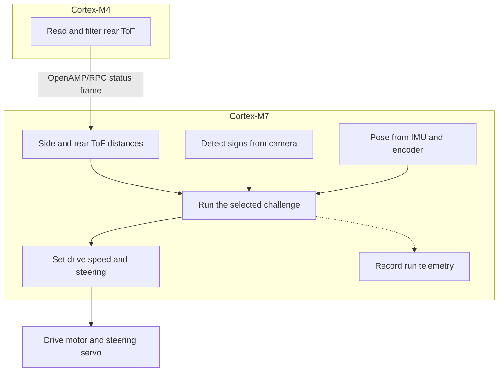

The side ToFs and the camera's configuration connection already use the GIGA's three hardware I²C buses. We gave the rear ToF a software I²C bus on the M4 so the M7 can keep processing images and controlling motion while the M4 reads the sensor. The M7 checks the status and age of each received reading. If a manoeuvre needs rear distance and the reading is stale or unavailable, it can wait for a fresh reading or stop.

| Firmware area | Entry points |
| --- | --- |
| M7 control | [Main loop](src/main.cpp#L54-L83) · [Mode update](src/mode_manager.cpp#L508-L546) · [Motor and steering outputs](src/motor_control.cpp#L311-L341) |
| M7 perception and pose | [Distance sensors](src/sensors.cpp#L365-L407) · [Vision update](src/vision.cpp#L783-L796) · [Pose update](src/position_estimator.cpp#L107-L134) |
| Rear sensor and RPC | [M4 sensor loop](src/m4/rear_tof_m4.cpp#L169-L184) · [M7 frame and freshness check](src/rear_tof_rpc.cpp#L40-L52) |
| Run records | [Telemetry phases and samples](src/run_telemetry.cpp#L71-L96) · [USB logger update](src/logger.cpp#L382-L418) |

### Open Challenge strategy

On the sign-free course, we use proportional–derivative (PD) steering to hold the course heading and maintain about **300 mm** from the followed wall. The proportional term corrects the current error, and the derivative term responds to how quickly it changes. PD was stable enough in our tests. We expected little gyro drift and no persistent wall-distance error that would require an integral correction.

We project a usable range with $d_{\perp}=d_{\mathrm{raw}}\cos(\theta_{\mathrm{error}})$, where $\theta_{\mathrm{error}}$ is the difference between the current heading and the target heading. [Wall-distance correction](src/navigation_controller.cpp#L104-L127) · [Open navigation states](src/navigation_controller.cpp#L518-L539)

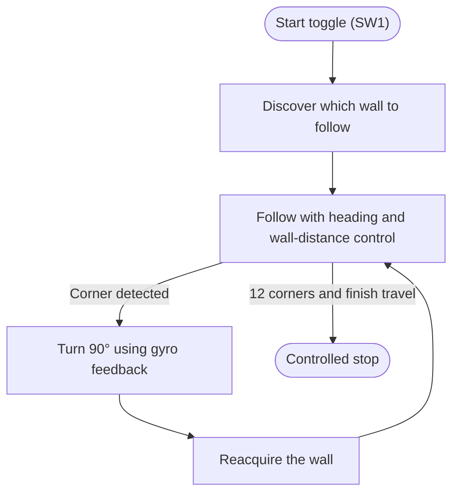

### Obstacle Challenge strategy

We estimate the car's position on the field from how far the wheels have travelled and which way the car is facing. Readings from walls and parking markers help correct that estimate. The route is a series of points. Our steering method, Pure Pursuit, chooses a point ahead and calculates how sharply to steer towards it. When joining a new path, we blend the steering target into it to avoid a sudden change. [Lookahead and steering calculation](src/obstacle_path.cpp#L8786-L8819)

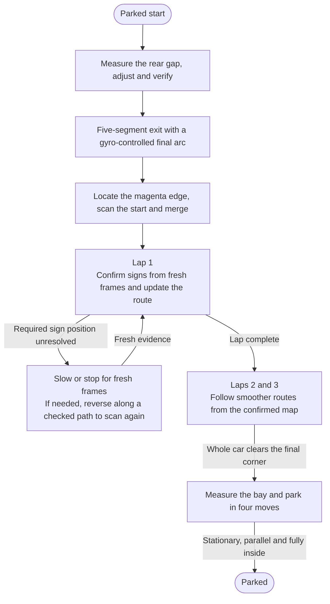

**Leaving the bay.** We use the rear ToF to measure the gap to the marker behind the car and adjust the starting position if needed. After leaving the bay, the car scans the starting straight. If it needs a better view of a possible sign location, it can make a short move after checking that the path is clear. It then joins the lap route through a checked connecting path. [Rear ToF parking setup](docs/guides/REAR_TOF_M4_SETUP.md#parking-position-configuration) · [Handoff from exit to lap route](src/obstacle.cpp#L3345-L3375)

**Mapping signs.** On lap 1, we match what the camera sees to one of the allowed sign positions on the field.

- **Occupied.** Two accepted frames must agree on the sign's colour and position. The fallback detector for hard-to-separate green signs requires **three** frames. The [modified sign](#modified-traffic-sign) has a separate height check. [Standard threshold](include/config.h#L1286-L1288) · [Green fallback threshold](include/config.h#L993)
- **Clear.** We normally require **two consecutive frames** with a clear view of the empty position. The target position checked just after leaving the parking bay requires **five**. An obstructed or ambiguous view cannot count as clear. When a station has two possible sign positions, both must be resolved as clear to mark the station empty. We can also use the official layout to rule out positions where signs cannot be placed. [Clear thresholds](include/config.h#L1314-L1323)

If a position remains unresolved, we [slow down and give the camera another look](#systems-integration-and-validation) before continuing past it.

On laps 2 and 3, we reuse the map to plan smoother routes. If two signs are close together, we check the path around both as one manoeuvre. We keep the already checked route whenever a proposed shortcut exceeds the planner's limits.

**Final parking.** We scan both parking markers to find where to start the manoeuvre. As we line up, we check that the body and wheels have room to move.

1. **Turn into the bay.** Reverse with the wheels turned fully until the car is **47°** from parallel to the bay.
2. **Move deeper into the bay.** Straighten the wheels and reverse **125 mm**.
3. **Bring the front in.** Turn the wheels fully the other way and reverse until the angle drops to **22.5°**.
4. **Straighten the car.** Switch the steering back and drive forward until the car is parallel to the bay.

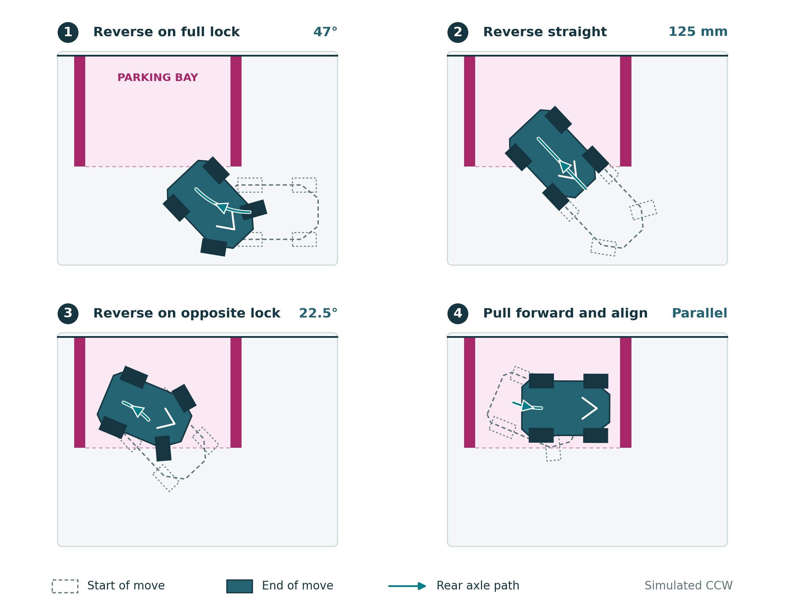

We mirror the steering for the opposite driving direction. We track distance with the encoder and heading with the IMU. While reversing, we stop if the rear ToF detects that we are too close to an obstacle. Once the car is still, we centre the steering and check that the estimated outline fits entirely inside the bay and the heading is within **2°** of parallel. [Four-move sequence](src/final_parking.cpp#L1796-L1805) · [Final pose check](src/final_parking.cpp#L2557-L2589)

Our target parking gap is **237.5 mm** between the inner faces of the two markers. The firmware starts at **247.5 mm**, or 1.5 times its configured robot length of **165 mm**, and accepts a measured gap within **±15 mm** of that estimate if it also passes the scan and pose checks. We use the accepted measurement to locate the movable marker. [Initial estimate](include/config.h#L405-L406) · [Bay wall calculation](src/final_parking.cpp#L216-L221)

#### Modified traffic sign

We use the camera calibration to estimate a sign's height from its top and base in the image. We check that the base has a plausible width and compare the height estimate with the detected red region when a short red sign could be mistaken for a normal one. We wait for a better view when those checks disagree. We confirm a modified sign only after **three fresh frames** agree on its colour and height class at the same mapped position and the map shows another sign comes first. [Height estimate and classification](include/obstacle_sign_height.h#L12-L50) · [Frame checks and votes](src/obstacle_path.cpp#L721-L795)

Once confirmed, we lock that position in the map. We keep the colour seen by the camera for diagnostics and store the opposite colour as the sign's original colour. The route planner uses that stored colour to choose the passing side on all three laps. [Confirmation and map update](src/obstacle_path.cpp#L707-L719)

## Systems Integration and Validation

**How the parking exit brings the subsystems together.** We use the rear ToF to measure the gap behind the car and the wheel encoder to limit how far the motor moves during a correction. Once the car stops, we compare the change in rear distance with the encoder travel and check that the gap is within tolerance. If either check fails, we allow one small retry when the remaining gap error is within the correction limit. If verification still fails, we hold the car in place. During the exit itself, we use the IMU heading to decide when the final steering arc has brought the car back parallel to its starting direction. The encoder caps how far that arc can continue. [Rear distance verification](src/obstacle.cpp#L1515-L1581) · [Final arc and braking](src/obstacle.cpp#L2023-L2090)

We used prototype observations, bench measurements and simulations to guide changes across the car. Each row shows what limited the earlier design, what we changed, and the resulting trade-off or test finding. In physical testing, contact or manual intervention counts as a failed attempt even if the controller reports completion.

| Subsystems | What drove the change | What we chose and what we learned |
| --- | --- | --- |
| Steering and chassis | The compact micro servo gave inconsistent wheel angles under load. | We made room for the larger MG90S to improve steering repeatability. Comparing CAD predictions with encoder and IMU measurements revealed a servo-neutral offset that we corrected in calibration. [Steering design](#chassis-and-steering) |
| Battery mounting and chassis | The commercial dual-cell holder restricted placement and made cell swaps awkward. | We printed two holders that fit low on opposite sides of the chassis. Each cell can now be reached from below, and the battery mass is spread across the chassis. [Underside layout](#chassis-and-steering) |
| Gearbox and motor control | In driving tests, the 50:1 gearbox was less consistent under load than the 100:1. We initially chose the 100:1, then needed more speed for the World Final. | We switched to 30:1 for speed, accepting less torque multiplication. We use encoder feedback and short power pulses to help the motor start and keep moving at crawl speeds, where tyre scrub in tight turns adds load. [Gearbox comparison and low-speed control](#drive-selection-and-low-speed-control) |
| Range sensors, IMU and wiring | A soldering fault damaged an early ToF module. Daisy-chained replacements shared the same startup address, and frequent ToF transactions made IMU readings unreliable on the shared bus. | We chose plug-in VL53L4CX modules for easier replacement and longer rated range. We gave each ToF its own bus and moved the IMU to SPI so heading updates can run independently of range transactions. [Sensor and wiring choices](#wiring-and-signal-interfaces) |
| Camera geometry and sign recognition | The earlier calibration classified the correct height in **11 of 45** reference images. The planner needs this classification to interpret a modified sign. | We recalibrated using known distances and sign heights. The revised method classified both colour and height in **45 of 45** reference images of centred stationary targets. [Camera validation](simulation/reports/SURPRISE_RULE_MEASURED_VALIDATION_20261119.md#results-and-changes) |
| Camera and first-lap speed | At full driving speed, we sometimes passed a sign before the camera had enough usable frames to confirm it. | We cap the approach at **120 mm/s**, pause for up to **800 ms**, and reverse along a checked path to scan from farther away. This recovered a missed green sign in physical testing. We added a short, checked forward move for cases where the retreat leaves the position too far away to classify. [Slowdown and hold](src/obstacle_path.cpp#L9080-L9124) · [Viewpoint selection](src/obstacle_path.cpp#L6300-L6376) |
| Sign map, route planning and vehicle footprint | Some routes around close signs left little room for real driving errors. | We adjust the route around nearby signs as a group and check the new path before using it. The current planner passed **2,811** known-map cases. In a separate footprint check, **7 of 2,827** cases fell below our **50 mm** modelling target, with a minimum sign clearance of **43.8 mm**. [Clearance checks and model limits](simulation/README.md#route-clearance-check) |
| Parking pose, steering and clearance | Some early entries finished poorly even when the controller reported completion. Tight entries depended on the turning radius and the space taken up by the steered wheels. | We use both markers to refine the entry position, run the same four moves from that position and check final containment. All **396** modelled approaches reached the entry position. Physical logs show both a firmware-confirmed park and a separate entry that looked successful to the tester but failed the firmware's final pose check. [Model](simulation/README.md#parking-entry-models) · [Confirmed containment](simulation/evidence/parking_exit_diagnostics/README.md#2026-11-22-log-48) · [Final pose discrepancy](simulation/evidence/parking_exit_diagnostics/README.md#2026-11-22-logs-53-and-54) |

## Build, Upload and Reproduction

### Build and run the firmware

Check out and update `main`, then run `git rev-parse HEAD` to record the exact version you are building. Open the repository root in VS Code with the PlatformIO extension and use the IDE-managed PlatformIO Core. [PlatformIO configuration](platformio.ini#L14-L50) defines the Arduino GIGA M4 and M7 environments and their dependencies. From the repository root in PowerShell:

```powershell
$pio = Join-Path $env:USERPROFILE '.platformio\penv\Scripts\platformio.exe'
& $pio run --environment giga_r1_m4
& $pio run --environment giga_r1_m7
```

For a complete installation, upload **M4 first, then M7** over USB. Later firmware changes require rebuilding the affected core, or both cores for shared interfaces.

```powershell
& $pio run --environment giga_r1_m4 --target upload
& $pio run --environment giga_r1_m7 --target upload
```

Configure the firmware before the attempt in `include/config.h`.

- **Challenge mode.** Set [`STARTUP_ROBOT_MODE`](include/config.h#L25) to `MODE_OPEN_CHALLENGE` for Open or `MODE_OBSTACLE_CHALLENGE` for Obstacle. The default Obstacle mode exits the parking bay, drives three laps and attempts final parking.
- **Obstacle Challenge participation.** Edit the value in [`#define OBSTACLE_SURPRISE_RULE_ENABLED 1`](include/config.h#L953) to match your declaration. Keep `1` (the default) if you are participating in the Modified Traffic Sign Surprise Rule. Change it to `0` if you are opting out and want the firmware to use ordinary sign handling.

After changing either setting, rebuild and upload the `giga_r1_m7` environment using the commands above. These settings are compiled into the uploaded firmware. With the start toggle (SW1) LOW, turn on the main power rocker (SW2) and wait for the controller to reach its waiting state. On the judge's signal, set SW1 HIGH. The robot then drives autonomously using its onboard sensors and controller.

### Reproduce the evidence

During bench work, read diagnostics and telemetry at **115200 baud**.

**Automatic USB logging.** Before a test, plug a FAT32-formatted USB flash drive into the GIGA’s USB host port. We buffer telemetry in RAM while driving and save it to a numbered `log_*.txt` file when the challenge ends or we set the start toggle (SW1) LOW. The GIGA shows red while writing and green after reading the file back and verifying it. Red and green together indicate a save error. Wait for the green light to go out before removing the drive. [Save and verification status](src/logger.cpp#L338-L378)

- **Steering calibration.** Follow the [CAD calibration workflow](CAD/README.md#workflow) to compare predicted turning radii with measurements from the robot.
- **Does the camera recognise the sign?** We test the detection software on images of signs whose colour and height we already know. Separate test cases check that the planner chooses the correct passing side for a modified sign. [How to rerun the sign check](simulation/README.md#sign-recognition-check)
- **Does the planned route leave enough room?** We simulate laps 2 and 3 with different sign layouts and measure how close the chassis and wheels come to the signs and walls in the model. [How to rerun the clearance check](simulation/README.md#route-clearance-check)
- **Can the car line up for parking?** We simulate the approach to the measured entry position and check the four moves in both driving directions. [How to rerun the parking check](simulation/README.md#parking-entry-models)
- **Physical test logs.** Find the original files and their firmware details, where available, in the [run evidence index](simulation/evidence/parking_exit_diagnostics/README.md). Use the [run inspector](tools/robot-run-inspector/README.md) to view a recorded run, or follow the [parking analysis instructions](simulation/README.md#parking-exit-model) to regenerate plots from the archived logs.

## Video

### Open Challenge

[](https://www.youtube.com/watch?v=koMCLdpg0-I)

### Obstacle Challenge

[](https://www.youtube.com/watch?v=5dCMkFn-6TI)

We filmed this run with an earlier version of our parking software. See the [current four-move parking sequence](#obstacle-challenge-strategy).

## Robot Photos

These six views show the current robot. The rear view shows the rear ToF sensor below the main power switch, and the bottom view shows both battery holders.

| Left | Rear | Right |
| :---: | :---: | :---: |
| 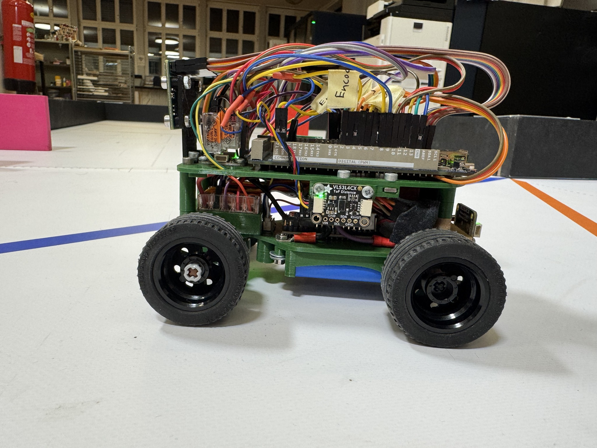 | 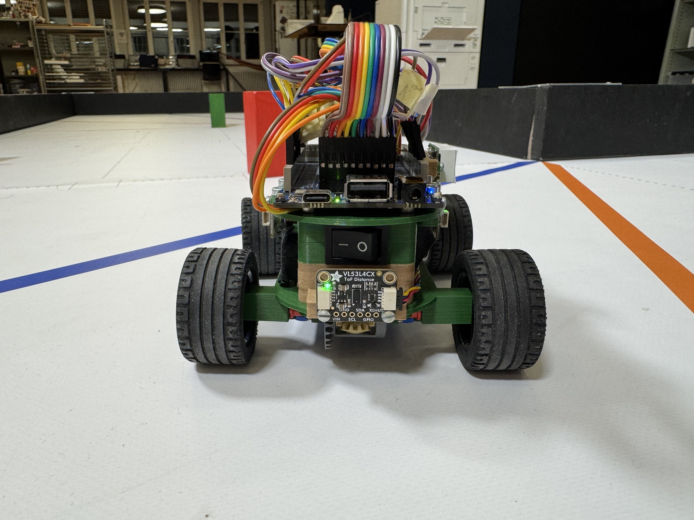 | 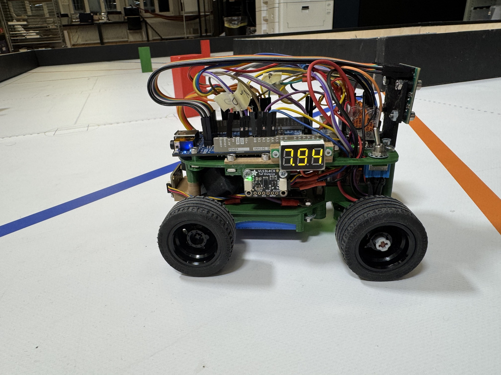 |

| Front | Top | Bottom |
| :---: | :---: | :---: |
| 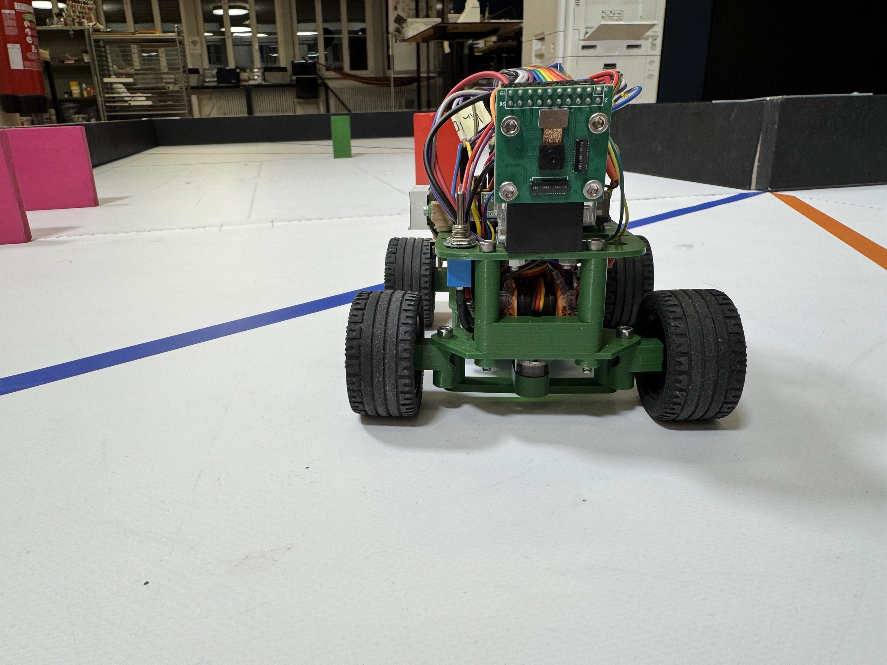 | 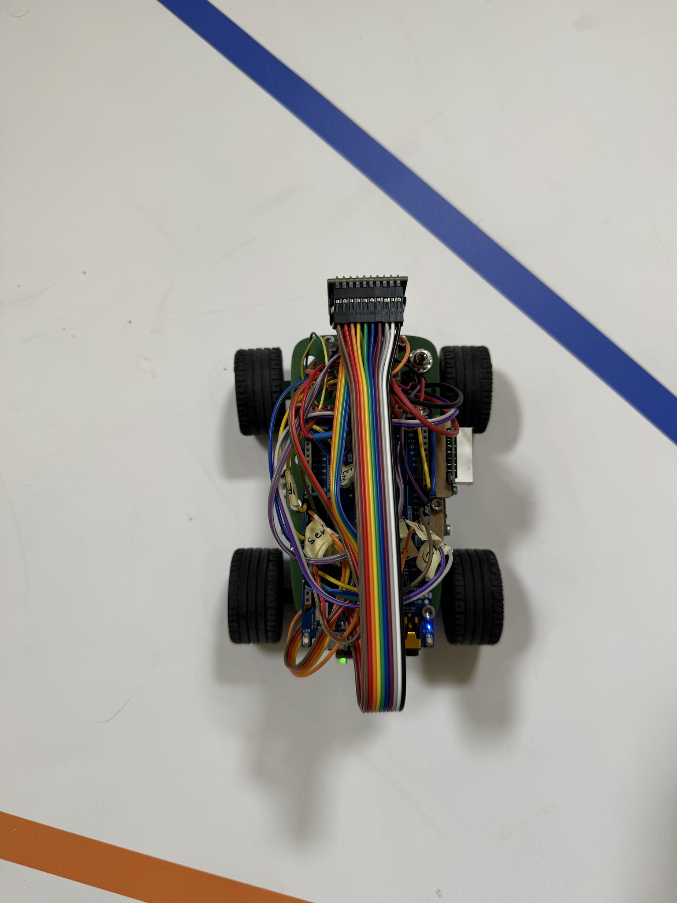 | 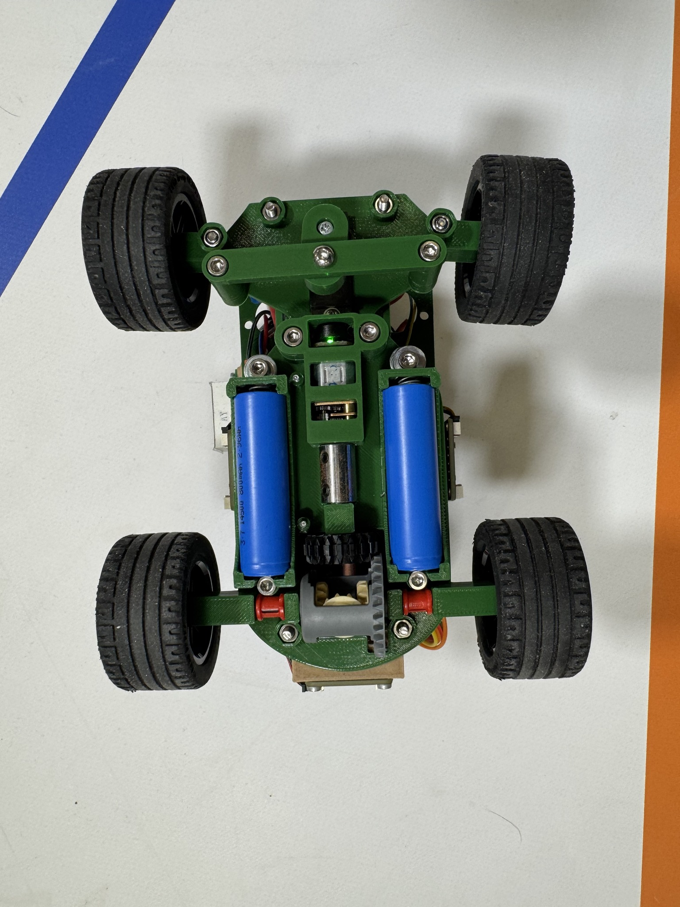 |

## AI Use Declaration

We used several AI systems to support our work, primarily OpenAI Codex (GPT Sol), with occasional use of Antigravity, GitHub Copilot and Cline. They helped us extend our Open Challenge firmware, develop the Obstacle Challenge solution and tune the camera frame rate with the robot connected. They also helped us build simulations, write tests, analyse logs, edit this README, estimate current draw, stabilise drone footage and create simulation visuals. We used these tools from our laptops. The robot drove autonomously using its onboard firmware.
