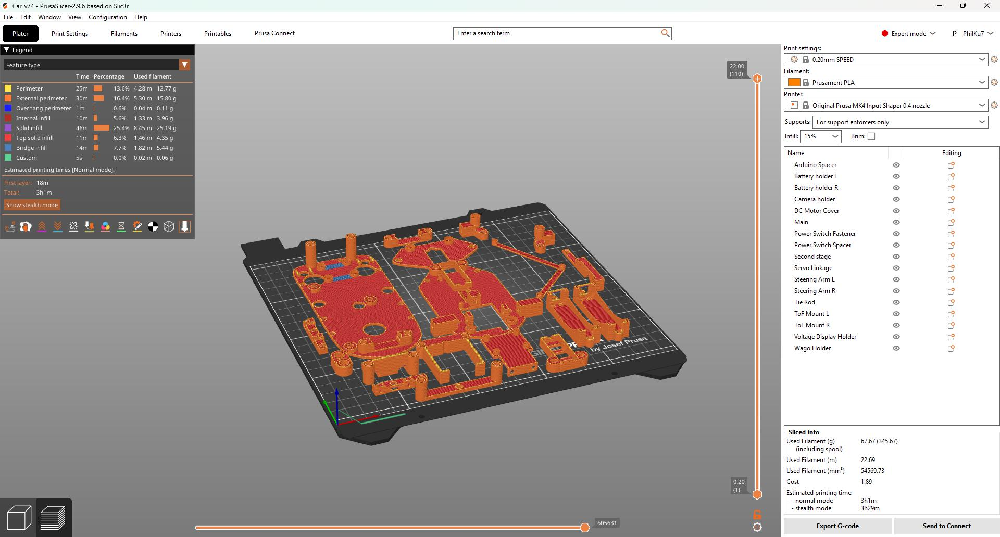
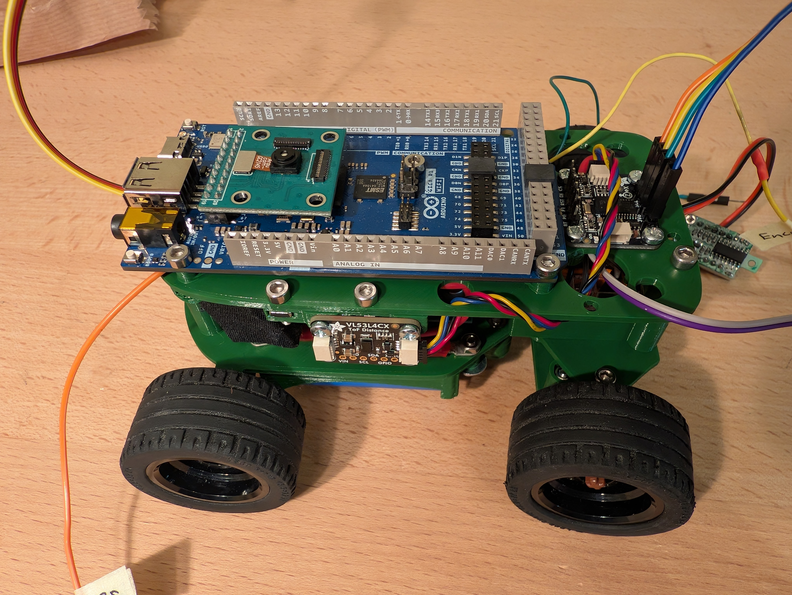
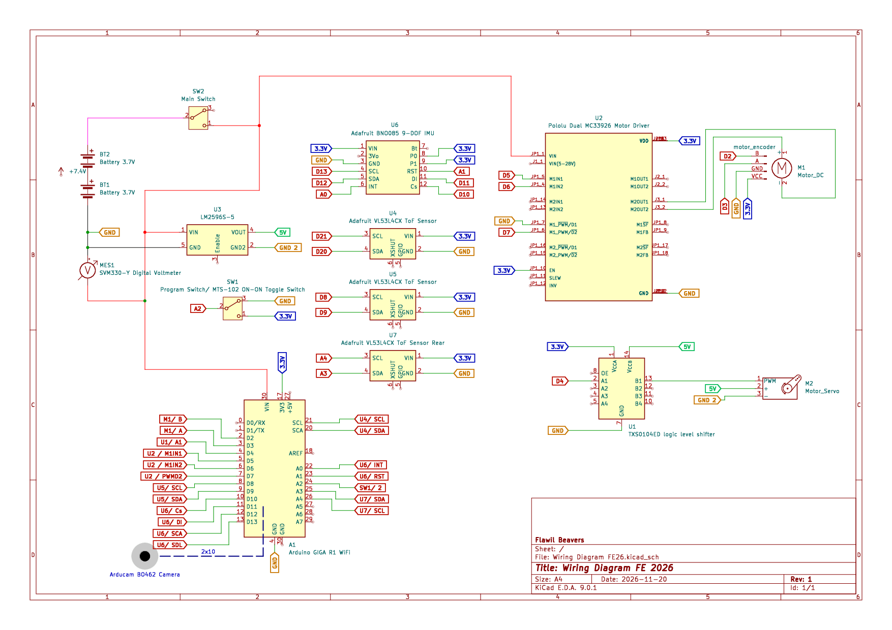
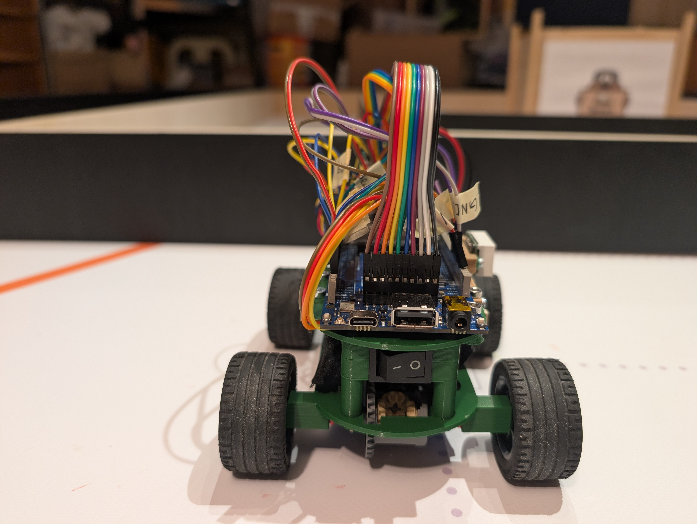
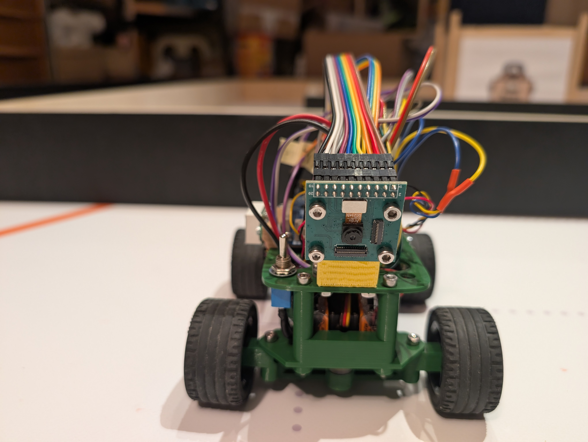

# WRO Future Engineers 2026 — Flawil Beavers

We are **Philipp Kündig** and **Damian Hardegger** from Flawil, Switzerland, coached by **Stefan Gemperli**. We designed and built a four-wheel autonomous car for the WRO 2026 Future Engineers World Final. It uses one rear drive motor, one Ackermann steering servo and on-board sensing and control for both challenges.


## Contents

- [Bill of Materials (BOM)](#bill-of-materials-bom)
- [Assembly](#assembly)
- [Mobility and Mechanical Design](#mobility-and-mechanical-design)
- [Power and Sensor Architecture](#power-and-sensor-architecture)
- [Software Architecture and Challenge Strategy](#software-architecture-and-challenge-strategy)
- [Systems Integration and Validation](#systems-integration-and-validation)
- [Build, Upload and Reproduction](#build-upload-and-reproduction)
- [Video](#video)
- [Robot Photos](#robot-photos)

# Bill of Materials (BOM)

| Component | Quantity | Function | Estimated CHF |
| --- | ---: | --- | ---: |
| Arduino GIGA R1 WiFi | 1 | M7 motion and vision, M4 rear distance sensor | 60.90 |
| Adafruit BNO085 | 1 | Fused heading | 24.95 |
| Adafruit VL53L4CX | 3 | Left, right and rear time-of-flight ranging | 59.70 |
| Qwiic/STEMMA QT cables | 3 | Detachable ToF connections | 23.10 |
| Arducam GC2145 camera | 1 | On-board traffic-sign vision | ~30.00 |
| Pololu Dual MC33926 motor driver | 1 | Bidirectional drive control | ~25.00 |
| [Adjustable Mini-360 DC-DC step-down module](https://sph.ethz.ch/materials/product/10.2.4) | 1 | Voltage regulation | ~2.00 |
| Generic 3.3 V to 5 V logic-level shifter | 1 | Signal-level translation | ~3.00 |
| [BerryBase SVM330-Y](https://www.berrybase.ch/detail/0191f2bebc0d71c7afa5fd3d0c6cde11) | 1 | Two-wire yellow LED voltage display, 0.28 in, 3.2–30 V | ~5.00 |
| MTS-102 ON-ON switches | 2 | Main power and physical start/enable | 7.60 |
| [DFRobot 6 V encoder gearmotor, 30:1](https://www.bastelgarage.ch/6v-530rpm-30-1-micro-gear-motor-with-encoder) | 1 | Rear-axle propulsion | 13.90 |
| TowerPro MG90S servo | 1 | Front steering linkage | 7.90 |
| 14500 Li-ion cells, 3.7 V and 750 mAh each | 4 total, 2 installed | One 2S pack on the robot and one spare pair | 31.60 |
| Printed chassis and mounts, including battery holders | 1 set, 2 holders | Supports and locates the mechanical and electronic assemblies | ~10.00 |
| 43.2 mm drive wheels, front wheels, gears, axles, bearings, fasteners and harness | 4 wheels, other parts as required | Transmission, rolling gear, assembly and power distribution | |
| **Total for priced items** | | **Recorded project estimates** | **304.65** |

# Assembly

## CAD and 3D printing

**Version 74 is the current CAD model, including the rear ToF mount.** The editable design, printable project and prepared job serve different stages of reproduction. The [CAD guide](CAD/README.md) also documents how to extract and check the steering geometry.

| Artifact | How to use it |
| --- | --- |
| [PrusaSlicer project](CAD/Car_v74.3mf) | Open as a project to load all 17 meshes with their arrangement and settings. Select your printer, nozzle and material profiles, then slice and inspect the preview. |
| [Autodesk Fusion archive](CAD/Car_v74.f3z) | Import the editable assembly and its linked design to inspect mount positions or export revised meshes. |
| [Prepared binary G-code](CAD/printing/Car_v74_0.4n_0.2mm_PLA_MK4IS_3h1m.bgcode) | Use with the Original Prusa MK4 Input Shaper, 0.4 mm nozzle and PLA configuration for which it was generated. |

| Plate arrangement | Toolpath preview |
| --- | --- |
|  |  |

The supplied PrusaSlicer 2.9.6 project uses the Prusament PLA profile, 0.2 mm SPEED layers, 15% infill, support enforcers only and no brim. The slicer estimates 67.67 g of filament and 3 h 1 min 6 s for the plate. The chassis was designed to print without supports.

## Mechanical assembly

Use M3 screws and M3nS/M3n nuts for the structural parts. Use M2 or M2.5 screws with matching nuts for electronic modules. Build the lower stage first to retain access to the drive, steering and battery holders. Then fit the sensor mounts and controller, route the harness through the upper stage and join the stages. The [v74 assembly](CAD/Car_v74.f3z) shows the rear sensor mount.

The photographs illustrate the original two-stage assembly sequence.

| Building Instruction | | |
|---|---|---|
|  Prepare all the printed parts |  Screw the servo linkage onto the servo |  Connect the tie rod to both of the steering arms using M3n nylon lock nuts |
|  Fit the drive coupling to the motor shaft|  Fix the DC motor onto the first stage using the DC Motor Cover and screw the servo in place|  Prepare the battery holders (2x) |
|  Screw the battery holders onto the first stage |  Connect protruding screws to the wires and screw nut on |  Use M2 screws to fix the motor driver in place and wire everything up (use Wagos for GND and VCC) |
|  Connect the lego gears, axles and wheels |  Now fasten the sensors to the Second Stage using M2.5 screws and nuts |  The ToF sensors are mounted via the ToF Mounts that are fastened with M3 screws |
|  Place the Arduino Giga on top of the Arduino Spacer and fasten with M3 Screws |  Route the power and signal wiring through the upper stage |  Thread the wires to the arduino through the Second stage |
|  Screw the second stage onto the first one | | |

# Mobility and Mechanical Design

## Chassis and steering

The screw-fastened two-stage chassis gives access to the drivetrain below and the sensors and controller above. A commercial dual-cell holder constrained the layout and made access awkward. We replaced it with two printed holders mounted low on opposite sides of the chassis. This gives each cell a directly accessible mount and distributes the battery mass across the chassis.


The steering arms are angled toward the centre of the rear axle so the inner front wheel turns more sharply than the outer wheel. This reduces scrub through a corner. The compact linkage trades steering travel for clearance at full lock. The first PDI-1102HB micro servo moved inconsistently under load. The larger MG90S improved repeatability and required more mounting space. Keeping the servo arm and tie rod in plane reduces binding.

The physical axle spacing is **98 mm**. The calibrated Ackermann model uses an effective wheelbase of **127 mm** to describe the installed linkage. After correcting a **+0.6°** mechanical neutral offset, the CAD model's mean turning-radius prediction error was **2.35%** across the tested 15°–40° steering magnitudes. The calibration report gives the measurement method and per-angle results. The measured parking contour is **158 mm** long straight and **170 mm** at full steering, with **123 mm** straight outside wheel width. The route model and bay-sizing configuration use their own geometry parameters. [Ackermann calibration](CAD/ACKERMANN_KINEMATICS_DOCUMENTATION.md) · [Measured parking contour](simulation/RETURNED_651_656_PARKING_20261105.md#measured-geometry-and-implementation)

## Drive selection and low-speed control

| Gearbox evaluated | Published gearbox-output speed and torque | Design decision |
| --- | --- | --- |
| 50:1 | 310 RPM, 0.35 kg·cm | Higher speed than the first retained motor, with less consistent loaded driving. |
| 100:1 | 155 RPM, 0.70 kg·cm | Initially retained for torque and consistent control under load. |
| 30:1 | 530 RPM unloaded, 300 RPM at the supplier's loaded test point, 0.2 kg·cm listed torque | Selected for higher speed for the World Final. The smaller reduction makes low-speed breakaway and full-lock driving more demanding. |

The quadrature decoder counts both edges of both channels. Seven encoder cycles per motor revolution and the 30:1 gearbox give **840 counts per gearbox-output revolution**. The separate wheel transmission multiplies this by **28/20** for **1,176 counts per wheel revolution**. Distance follows from the 43.2 mm drive-wheel diameter. [Drive constants](include/config.h) · [Motor and encoder implementation](src/motor_control.cpp)

A hard minimum PWM cutoff caused the motor to alternate between long powered and unpowered periods at crawl speed. The controller now uses **pulse-density modulation** at requested speeds up to **120 mm/s**. For low average effort it distributes powered slots of **5 ms** at a **120/255 PWM** carrier. The 200 Hz slot rate sets the spacing of decisions about whether to power each slot. Encoder-based PI, feed-forward and bounded steering-load compensation regulate the average effort. Loaded floor tests inform the tuning because wheel scrub and battery voltage change the breakaway effort.

In the straight 80 mm/s floor comparison (runs 204 and 205, about 8.0 V), increasing the low-speed integral gain raised mean speed from **59.4 to 71.0 mm/s** after the transition samples. The improved run still ranged from **45.5 to 96.4 mm/s**. The forward 60 mm/s straight and both full-lock cases met the ±10 mm/s **mean** criterion (runs 206, 208 and 209). The spread illustrates why mean speed alone is insufficient for judging parking smoothness.

# Power and Sensor Architecture

## Power budget

Two 14500 Li-ion cells in series give **7.4 V nominal, 8.4 V fully charged and 750 mAh nominal pack capacity**. The robot uses an adjustable Mini-360 step-down module, a 3.3 V to 5 V signal shifter and a two-wire voltage display. The module supplier lists 3 A for the regulator. That listing is a component rating, and the current planning estimates below do not establish its continuous operating load in the installed chassis. [Regulator listing](https://sph.ethz.ch/materials/product/10.2.4)

| Component group | Typical planning estimate | Peak-scenario estimate |
| --- | ---: | ---: |
| Drive motor | 300 mA | 800 mA |
| Steering servo | 250 mA | 700 mA |
| Controller, camera, IMU, three ToFs and auxiliary electronics | 492 mA | 492 mA assumed |
| **Arithmetic sum across component rails** | **1,042 mA** | **1,992 mA** |

The budget combines datasheet-based estimates and engineering allowances. It highlights the drive motor and servo as the largest changing loads. The sums use component currents on different rails. Battery-side current depends on rail voltages and conversion efficiency, and the peak estimate assumes the listed loads occur together. The design uses encoder feedback to compensate for speed changes within available motor effort as the pack discharges.

## Wiring and signal interfaces

[](Electronics/Wiring_Diagram_FE2026_v1.png)

The interface map below lists the firmware pin assignments.

| Function | Interface |
| --- | --- |
| Drive motor and encoder | Motor driver direction D5/D6 and PWM D7, quadrature encoder D3/D2 |
| Steering servo signal | D4 |
| BNO085 IMU | SPI with chip select D10, interrupt A0 and reset A1 |
| Left and right VL53L4CX | Separate M7 hardware I²C buses, `Wire` and `Wire2` |
| Rear VL53L4CX | M4 software I²C at 100 kHz, SDA A3 and SCL A4 |
| Arducam GC2145 | GIGA camera connector, DCMI pixel input and I²C configuration |
| Physical start/enable | A2, active HIGH |
| Rear measurement transfer | On-chip OpenAMP/RPC, fixed-size frames with sequence and status |

[Firmware pin assignments](include/config.h) · [M7 sensors](src/sensors.cpp) · [M4 rear-ToF service](src/m4/rear_tof_m4.cpp) · [RPC protocol](include/rear_tof_rpc_protocol.h)

## Heading and distance sensing

**Heading.** The BNO085 supplies a **100 Hz game rotation vector**. Its yaw uses fused gyro and accelerometer data. A magnetometer reference gave unstable heading in the vehicle, where the drive and wiring were possible sources of interference. The filter uses no magnetic reference. The encoder supplies travel for the position estimate.

**Side distance.** The side-facing VL53L4CX modules give symmetric wall observations for clockwise and counterclockwise starts. Using the sensors on separate buses avoids shared-address startup sequencing. Detachable Qwiic cabling replaced directly soldered VL53L3CX modules after a module was damaged during assembly. That change also made the sensors easier to replace and troubleshoot.

**Wall-edge timing.** The side sensors normally use a **30 ms** budget and a **600 mm** configured range limit. Initial direction discovery in Open uses **300 ms** for dark-wall returns, then restores 30 ms when the followed side is confirmed. The control filter checks measurement status, signal and uncertainty and caps consecutive valid in-range changes at **100 mm**. Out-of-range transitions bypass that cap. The sensor sees a cone, so the old wall can remain visible beyond the centreline crossing and a perpendicular wall can return obliquely. Encoder travel and heading help establish the corner when range alone is ambiguous.

**Rear parking reference.** The rear sensor observes the inside face of a magenta bay piece. In the start model its sensing face is **15 mm** ahead of the rearmost point, so a **65 mm** sensor target corresponds to **50 mm** rear-body clearance. The controller uses three fresh stationary samples spanning at most **4 mm**, a **±5 mm** target tolerance and an **8 mm** travel-agreement gate between rear range and encoder movement. The M4 rear sensor uses a **30 ms** budget and **370 mm** software range limit. [Parking configuration](include/config.h) · [Rear sensor service](src/m4/rear_tof_m4.cpp)

## Camera and calibration

The **Arducam GC2145** uses the wide 1616 × 1208 readout window, subsampled to **320 × 240**. A previous centre crop reduced visibility at the edges of a traffic-sign station. For the wide view we use known sign placements to calibrate bearing, principal point and ground-plane range from the visible base. Colour segmentation and blob geometry provide candidates. Height is inferred separately from the top and the ground contact when both are usable. This keeps the distance estimate usable when the top is clipped and prevents incomplete height evidence from changing the passing rule.

The original synchronous capture and processing held the main loop for roughly **149 ms** per result. The project driver instead uses continuous **DCMI/DMA double buffering** in external SDRAM. DMA fills one buffer while the M7 processes the other. The interrupt publishes a completed buffer, and the main loop handles ownership and cache invalidation before reading it. Continuous capture also eliminated the observed double-length intervals caused by restarting snapshots near a frame boundary. In the stationary dual-colour test (run 76), both targets were valid on **2,025 evaluated frames**, with **79.62–79.63 ms** frame intervals, no capture errors and roughly **6.5–7.6 ms** of main-loop work per result.

The current source selects a **24 MHz external clock with input divide-by-two**. The clock divider preserves the intended internal timing. A faster internal PLL profile produced lighting bands and incomplete detections, so we retained the proven clocking. Separately, removing 50 idle vertical blanking lines reduced the recorded interval to about **76.5 ms** (run 111). [Capture driver](lib/arducam_dvp_async/src/arducam_dvp.cpp) · [GC2145 setup](lib/arducam_dvp_async/src/GC2145/gc2145.cpp) · [Vision implementation](src/vision.cpp)

# Software Architecture and Challenge Strategy

## Control ownership and data flow

| Path | Source and responsibility |
| --- | --- |
| M7 mode and control loop | [Main loop](src/main.cpp) and [mode manager](src/mode_manager.cpp) own actuator access. [Motor control](src/motor_control.cpp) applies speed and steering requests. |
| M7 perception and pose | [Sensors](src/sensors.cpp), [vision](src/vision.cpp) and [position estimator](src/position_estimator.cpp) combine heading, distance and traffic-sign observations. |
| M4 rear range | [Rear-ToF service](src/m4/rear_tof_m4.cpp) owns the remaining sensor and its synchronous software-I²C transactions. [M7 RPC receiver](src/rear_tof_rpc.cpp) consumes the most recent status frame and invalidates stale or failed data. |
| Challenge controllers | [Open navigation](src/navigation_controller.cpp), [Obstacle start](src/obstacle.cpp), [route generation and tracking](src/obstacle_path.cpp) and [final parking](src/final_parking.cpp) generate motion requests. |
| Run evidence | [Telemetry](src/run_telemetry.cpp) and the [logger](src/logger.cpp) record run stages, decisions and aborts for offline analysis. |

Both side sensors and the camera configuration already use the three hardware I²C interfaces. M4 services the rear software bus while M7 continues motion control and vision. A missing rear sample is explicit, so a phase that needs a fresh measurement can hold or stop.

## Open Challenge strategy

The sign-free course can be followed from heading and wall range. A gyro PD loop holds cardinal headings. A second PD term corrects the followed-wall distance around **300 mm** when the range is usable. We project measured range with $d_{\perp}=d_{\mathrm{raw}}\cos(\theta_{\mathrm{error}})$ to compensate for vehicle yaw relative to the wall. The turn uses gyro feedback for the 90° change, and the controller reacquires the wall after the turn.

```text
Ready → Follow with heading and wall PD
             ├─ corner accepted → Gyro-controlled turn → Reacquire wall → Follow
             └─ twelve corners + finish travel → Controlled stop
```

## Obstacle Challenge strategy

The vehicle keeps a fixed field frame. Wheel travel and fused yaw provide dead reckoning, and trusted wall or marker observations provide bounded pose corrections. A sampled baseline route connects straight sections and turns. Pure Pursuit converts an adaptive lookahead target into curvature and an Ackermann steering request. A continuous lookahead supports a smooth connector into each route and limits the steering discontinuity when switching maps or manoeuvres.

| Phase | Decision and transition |
| --- | --- |
| **Parked start** | Verify the stationary rear range and correct the longitudinal start if required. Execute a mirrored, five-segment Ackermann exit with a gyro-terminated final arc. Side range across a magenta edge helps register the pose. Scan the start seats, use a checked scout if needed, then merge through a preflight-checked connector. |
| **Lap 1** | Convert accepted colour blobs into positions in the field frame. Associate them with legal traffic-sign seats and confirm with independent frames. Update the route around confirmed signs. Brake, collect fresh evidence or use a bounded, swept-path-checked viewing motion when a required seat remains unresolved. |
| **Laps 2 and 3** | Use the confirmed map to prepare smoother routes. Where nearby signs compete for space, stage the bypasses and check the combined path. Optional shortening keeps the checked route available if a candidate exceeds the geometry, dynamics or planning budget. |
| **Final parking** | After the whole-vehicle corner-clear gate, approach from the established field frame and register both magenta faces. Check measured bay geometry, then select and track a swept entry path. Recheck the remainder if steering response or stopping differs from the plan. Stop when stationary, parallel, with straight wheels and the measured footprint contained. |
| **Safety checks throughout** | Gate motion on fresh required sensors, reachable steering, progress, pose error and a checked swept footprint. Missing evidence can trigger a bounded retry. A failed required gate ends in a controlled stop. |

The car drives to the **right of ordinary red signs** and the **left of ordinary green signs**. For the International Final, the three outer-row stations on the parking straight are unavailable. The bay is **200 mm deep** and its official length is **1.5 × the parking-relevant robot length**. Judges measure the parts within 100 mm of the mat that could interact with the bay walls. The firmware's bay-sizing input of **165 mm** models a nominal **247.5 mm** gap. Parking entry checks the steering-dependent contour during motion. [General Rules and field references](WRO_2026_RULES.md) · [Official Q&A](https://wro-association.org/competition/questions-answers/)

### Modified traffic sign

Participation is declared before the attempt. One eligible sign can change to the opposite colour and **50 mm or 150 mm** tall, compared with the standard **100 mm**. The first sign encountered is excluded. With participation enabled, three independent height confirmations and the seat policy establish the modified sign. The route stores its inferred **original** colour at that seat and uses it for all three laps. This means passing to the left of a modified sign that appears red and to the right of one that appears green. [Official Surprise Rule](https://wro-association.org/wp-content/uploads/WRO-2026-Future-Engineers-Extra-Task.pdf) · [Height classification](include/obstacle_sign_height.h)

# Systems Integration and Validation

We evaluate physical runs, bench tests and host models against their own conditions. A physical observation of contact or an intervention counts as an unsuccessful attempt in our test record, even if the controller reports completion.

| Engineering question | Evidence and decision |
| --- | --- |
| Can the car clear the bay and finish the exit parallel? | A five-segment trial at the earlier 45 mm rear placement completed without contact. The gyro-terminated last segment travelled **162.6 mm**, with **0.9°** final logged heading error (run 122). This supported using bounded heading feedback for the last arc. [Parking-exit study](simulation/PARKING_EXIT_PATH_SIMULATION.md) |
| Does the rear reference agree with encoder travel under load? | At a reported **7.16 V**, one run corrected the rear range from **46.3 to 60.7 mm** with **15.7 mm** encoder travel. The settled target error was **4.3 mm** and the motion-agreement error was **1.4 mm** (run 227). This supported a stationary verification gate after the bounded correction. |
| Can the current calibration distinguish sign heights? | The previous calibration assigned the correct height class to **11/45** approved images. The revised ground-plane and height calibration classified colour and height correctly in **45/45** approved mounted-camera frames of centred stationary targets. Maximum forward-distance error was **13.1 mm**. Logged CW runs also show the expected effective colour for examples of both modified heights. The bench result covers the sampled distances and viewing conditions. [Camera validation](simulation/SURPRISE_RULE_MEASURED_VALIDATION_20261119.md) · [Physical run review](simulation/CW_LOGS_3_6_REVIEW_20261119.md) |
| What happens when parking departs from the model? | In earlier physical testing, runs **655/656** were reported nearly perfect CCW. CW run **651** was reported poor or incomplete despite estimated completion, and **654** aborted during replanning. In the later accepted-span model stress test, **114/120** cases parked and six safely aborted at **232.5 mm** with radius variation. The design retains marker registration, a checked rescan and a bounded recovery path. [Physical runs](simulation/RETURNED_651_656_PARKING_20261105.md) · [Model stress and physical observations](simulation/CW_LOGS_3_6_REVIEW_20261119.md) |
| Can a learned route improve clearance while preserving passing sides? | A **2,807-case** known-map check retained the required passing sides. Using polygons based on the measured robot footprint, the model gave minimum clearances of **54.0 mm** to signs and **66.9 mm** to the inner wall at sampled points. Slip, pose error and actuator lag can change physical clearances. [Later-lap clearance study](simulation/LAP23_CLEARANCE_REVIEW_20261120.md) |

The current controller can prepare the parking approach during laps two and three. A rolling CCW handoff is conditional on its checked arrival path. A CW reversal waits for the braking gate. The handoff study records the host checks and the conditions for accepting each handoff. [Direct parking handoff](simulation/DIRECT_PARKING_HANDOFF_20261119.md)

# Build, Upload and Reproduction

## Build and run the firmware

Clone the public repository, open the root in VS Code with the PlatformIO extension, and use the IDE-managed PlatformIO Core. [PlatformIO configuration](platformio.ini) defines the Arduino GIGA M4 and M7 environments and their dependencies. From the repository root in PowerShell:

```powershell
$pio = Join-Path $env:USERPROFILE '.platformio\penv\Scripts\platformio.exe'
& $pio run --environment giga_r1_m4
& $pio run --environment giga_r1_m7
```

For a complete installation, upload **M4 first, then M7** over USB. Later firmware changes require rebuilding the affected core, or both cores for shared interfaces.

```powershell
& $pio run --environment giga_r1_m4 --target upload
& $pio run --environment giga_r1_m7 --target upload
```

Choose the challenge before the attempt using `STARTUP_ROBOT_MODE` in [the configuration](include/config.h), then rebuild and upload M7. The source on `main` defaults to `MODE_OBSTACLE_CHALLENGE`, which exits parking, drives three laps and attempts final parking. For Open, select `MODE_OPEN_CHALLENGE`. Set `OBSTACLE_SURPRISE_RULE_ENABLED` to match the declared Obstacle participation. With the physical enable switch LOW, power on and let the controller reach its waiting state. On the judge's signal, set the physical start switch HIGH. The driving program uses onboard sensing and control, without a live computer or radio link.

## Reproduce the evidence

Use the latest [main branch](https://github.com/flawil-beavers/Future-Engineers_2026/tree/main) for the actively maintained firmware. Record `git rev-parse HEAD`, the challenge mode and any local settings for comparisons, because `main` continues to receive improvements. Capture diagnostics and run telemetry can be read during bench work at **115200 baud**. Each physical run record should pair logged state with the observed contact, intervention and finish result.

| Check | From the repository root |
| --- | --- |
| Steering calibration geometry | Follow the [CAD calibration workflow](CAD/README.md#workflow). |
| Approved sign images and rule cases | `python simulation/check_surprise_rule.py` |
| Later-lap polygon clearances | Run `python simulation/check_later_laps.py` to generate the case matrix, then `python simulation/check_later_lap_physical_clearance.py`. |
| Archived parking pose and range reports | `python simulation/analyze_parking_exit_batch.py` |

The sign and clearance checks use Python and a C++17-capable `g++` on PATH. The [simulation guide](simulation/README.md) explains the distinction between model fixtures, observed runs and generated reports. The [run evidence index](simulation/evidence/parking_exit_diagnostics/README.md) identifies original records, firmware information when available and SHA-256 hashes. The [run inspector](tools/robot-run-inspector/README.md) visualizes the recorded telemetry.

# Video

## Open Challenge

[](https://www.youtube.com/watch?v=koMCLdpg0-I)

## Obstacle Challenge

[](https://www.youtube.com/watch?v=5dCMkFn-6TI)

# Robot Photos

These six views document the June build before the rear sensor was added.

|  |  |  |
|---|---|---|
|  |  |  |
