# WRO Future Engineers 2026 – Flawil Beavers 🇨🇭

## Team Introduction

We are the **Flawil Beavers**, a team from Switzerland competing in the WRO Future Engineers 2026 category.

This documentation presents our autonomous vehicle, including its mechanical design, electronics and software. Our goal was to build a reliable and efficient robot capable of successfully completing the competition challenges.

## Team Members

<table>
<tr>
<td valign="top">

<b>Team Members</b>

Philipp Kündig <br>
Damian Hardegger

</td>
<td valign="top">

<b>Coach</b>

Stefan Gemperli

</td>
</tr>
</table>

<br>


## Table of Contents

- [Team Introduction](#team-introduction)
- [Team Members](#team-members)
- [Bill of Materials (BOM)](#bill-of-materials-bom)
- [Assembly](#assembly)
- [Mechanical Design](#mechanical-design)
- [Mobility System](#mobility-system)
- [Steering System](#steering-system)
- [Power Budget](#power-budget)
- [Electronics Architecture](#electronics-architecture)
- [Sensor Architecture](#sensor-architecture)
- [Distance Sensors](#distance-sensors)
- [Camera System](#camera-system)
- [Wiring Diagram](#wiring-diagram)
- [Software Architecture](#software-architecture)
- [Navigation Strategy](#navigation-strategy)
- [State Machine](#state-machine)
- [Engineering Testing and Iteration](#engineering-testing-and-iteration)
- [Build, Upload and Operation](#build-upload-and-operation)
- [Video](#video)
- [Robot Photos](#robot-photos)
- [Failure Mode Analysis](#failure-mode-analysis)
- [Conclusion](#conclusion)

<!-- TODO (World Final documentation):
Keep DOCUMENTATION_TODO.md synchronized with the physical robot and competition
software. Complete its checklist before the final repository deadline, then
regenerate README.pdf and remove or resolve the remaining inline TODO comments. -->

<!-- World Final documentation maintenance is tracked separately in the [Documentation TODO](DOCUMENTATION_TODO.md). -->

# Bill of Materials (BOM)

## Electronics

| Component                           | Quantity | Purpose                                 |
| ----------------------------------- | -------- | --------------------------------------- |
| Arduino GIGA R1 WiFi                | 1        | Main robot controller                   |
| Adafruit BNO085 9-DOF IMU           | 1        | Gyroscope-based orientation measurement |
| Arducam BO462 Camera                | 1        | Object and colour detection             |
| Adafruit VL53L4CX ToF Sensor        | 3        | Wall tracking, clearance and rear parking reference |
| Qwiic/STEMMA QT sensor cable        | 3        | Replaceable sensor communication        |
| Pololu Dual MC33926 Motor Driver    | 1        | Drive motor control                     |
| LM2596S-5 DC-DC Converter           | 1        | Voltage regulation for electronics      |
| TXS0104E Logic Level Converter      | 1        | 3.3V ↔ 5V signal level translation      |
| SVM330-Y Digital Voltmeter          | 1        | Battery voltage monitoring              |
| MTS-102 ON-ON Toggle Switch         | 2        | Main power and physical enable/start    |

## Drive System

| Component                                        | Quantity | Purpose                 |
| ------------------------------------------------ | -------- | ----------------------- |
| DFRobot 6 V 530 RPM Encoder Motor (1:30 reduction) | 1        | Main drive motor        |
| Rear Drive Wheels (43.2 mm diameter)             | 2        | Vehicle propulsion      |
| Axles and Bearings                               | Various  | Mechanical transmission |

### Alternative Motor Tested

| Component                                       | Quantity | Result                                                            |
| ----------------------------------------------- | -------- | ----------------------------------------------------------------- |
| DFRobot Micro Metal Geared Motor 310 RPM (50:1) | 1        | Rejected due to insufficient torque and lower driving consistency |

## Steering Components

| Component                       | Quantity | Purpose              |
| ------------------------------- | -------- | -------------------- |
| TowerPro MG90S Metal Gear Servo | 1        | Front wheel steering |

### Alternative Servo Tested

| Component                         | Quantity | Result                                       |
| --------------------------------- | -------- | -------------------------------------------- |
| PDI-1102HB 2g Digital Micro Servo | 1        | Rejected due to insufficient steering torque |

## Power System

| Component                           | Quantity | Purpose                 |
| ----------------------------------- | -------- | ----------------------- |
| 14500 Li-Ion Battery (3.7V, 750mAh) | 4 total (2 installed) | 2S robot pack plus one charging/spare 2S pair |
| Custom 3D Printed Battery Holder    | 2        | Secure battery mounting |
| Battery Wiring Harness              | 1        | Power distribution      |

### Previous Design

| Component                      | Quantity | Result                                                         |
| ------------------------------ | -------- | -------------------------------------------------------------- |
| Commercial 2xAA Battery Holder | 1        | Replaced due to inefficient mounting and reduced accessibility |

## Mechanical Components

| Component                 | Quantity | Purpose               |
| ------------------------- | -------- | --------------------- |
| Custom 3D Printed Chassis | 1        | Main robot structure  |
| Custom Sensor Mounts      | Multiple | Sensor positioning    |
| Custom Battery Holders    | 2        | Battery retention     |
| Screws, Nuts and Spacers  | Various  | Assembly and mounting |

## Robot Specifications

The team confirms that the rear-ToF addition does not change the overall dimensions. The table distinguishes the nominal route/exit model from the latest measured parking contour, recorded in the [measured-envelope report](simulation/RETURNED_651_656_PARKING_20261105.md).

| Parameter              | Value                |
| ---------------------- | -------------------- |
| Earlier Recorded Mass  | 670 g; remeasurement required after rear-ToF addition |
| Physical Wheelbase     | 98 mm measured; nominal lap model uses 100 mm |
| Nominal Track Width    | 100 mm               |
| Nominal Robot Length Used for Bay Sizing | 165 mm |
| Measured Straight Longitudinal Extent | 158 mm (35 mm rear + 98 mm wheelbase + 25 mm front) |
| Measured Full-Steering Longitudinal Extent | 170 mm (35 + 98 + 37 mm) |
| Measured Straight Outside Wheel Width | 123 mm; general route/exit envelope retains 125 mm |
| Nominal Maximum Swept Width | approximately 135 mm; steering-dependent footprint checked along each path |
| Wheel Diameter         | 43.2 mm              |
| Drive Configuration    | Rear-Wheel Drive     |
| Steering Configuration | Front-Wheel Steering |

The 127 mm effective wheelbase in the calibrated Ackermann model is a turning-model parameter, separate from the 98 mm physical axle spacing. Final-parking checks include the measured front reach at full steering; a straight bounding box alone is insufficient.

## Cost Overview

| Component                      | Approximate Cost (CHF) |
| ------------------------------ | ---------------------- |
| Arduino GIGA R1 WiFi           | 60.90                  |
| BNO085 IMU                     | 24.95                  |
| VL53L4CX Sensors (3x)          | 59.70                  |
| Qwiic Cables                   | 23.10                  |
| MG90S Servo                    | 7.90                   |
| DFRobot 530 RPM Encoder Motor | 13.90                  |
| 14500 Batteries (4x)           | 31.60                  |
| Voltmeter                      | ~5.00                  |
| Switches                       | 7.60                   |
| Pololu MC33926 Driver          | ~25.00                 |
| LM2596S-5 DC-DC Converter      | ~2.00                  |
| TXS0104E Logic Level Converter | ~3.00                  |
| Arducam BO462 Camera           | ~30.00                 |
| 3D Printed Parts               | ~10.00                 |

### Estimated Total Cost

**Approximately 304.65 CHF for the listed items**, including four batteries (two installed and two spare).

These are recorded project estimates rather than current quotations. Fasteners, additional wiring, shipping and other spares can change the total.

# Assembly

Gather the required materials from the [Bill of Materials (BOM)](#bill-of-materials-bom). The current supplied mechanical design is version 74. Its PrusaSlicer project, editable Fusion 360 archive, prepared print job and slicer screenshots are linked below. The [CAD guide](CAD/README.md) describes the files and the steering-analysis workflow.

## CAD and 3D Printing

| File | Purpose |
| --- | --- |
| [Car v74 PrusaSlicer project](CAD/Car_v74.3mf) | Printable parts with their build-plate arrangement and slicer settings. Open as a project in PrusaSlicer to prepare a print or adapt the settings to your printer. |
| [Car v74 Fusion 360 archive](CAD/Car_v74.f3z) | Editable assembly, including the linked second-stage design. Import into Autodesk Fusion to inspect or modify the parts and export meshes for slicing. |
| [Car v74 binary G-code](CAD/printing/Car_v74_0.4n_0.2mm_PLA_MK4IS_3h1m.bgcode) | Prepared print job for the Original Prusa MK4 Input Shaper with a 0.4 mm nozzle and PLA. |

The version 74 parts are arranged together on one build plate in PrusaSlicer 2.9.6. The plate includes the chassis stages, battery holders, camera holder, motor cover, steering parts, ToF mounts, spacers and switch/display holders. The screenshots show the part arrangement and the resulting toolpaths.

| Preparation | Sliced toolpaths |
| --- | --- |
|  |  |

| Print setting | Supplied version 74 job |
| --- | --- |
| Slicer | PrusaSlicer 2.9.6 |
| Printer | Original Prusa MK4 Input Shaper |
| Nozzle | 0.4 mm |
| Material | Prusament PLA profile |
| Layer height | 0.2 mm, SPEED profile |
| Infill | 15% |
| Supports | For support enforcers only, as shown in the preparation screenshot |
| Brim | Disabled |
| Estimated filament | 67.67 g, approximately 22.69 m |
| Estimated printing time | 3 h 1 min 6 s in normal mode |

The chassis parts were designed to print without supports. The supplied slicer profile enables supports only where support enforcers are applied. The time and material values above are slicer estimates. The `.bgcode` file contains the prepared printer instructions for this configuration.

To prepare your own print, download the [version 74 `.3mf` project](CAD/Car_v74.3mf) and open it as a project in PrusaSlicer to load the parts, arrangement and settings together. Select the profile for your printer, nozzle and material, review the sliced preview, then export the print job. The Fusion archive provides the editable mechanical design if you need to modify a part before slicing.

## Mechanical Assembly

Use **M3 screws** and **M3nS/M3n nuts** for mechanical components, and **M2 and M2.5 screws** with **M2n and M2.5n nuts** for electronic parts.

Build the base first, then work up to the second stage, wiring components as they are installed. The following photographs show the earlier assembly sequence, before the rear-ToF addition.

| Building Instruction | | |
|---|---|---|
| 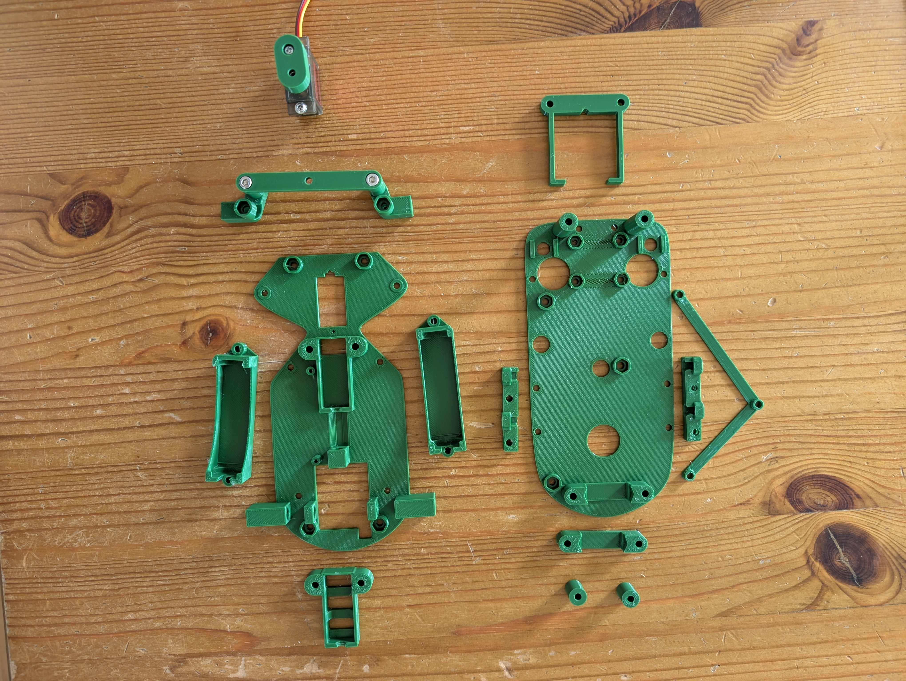 Prepare all the printed parts |  Screw the servo linkage onto the servo | 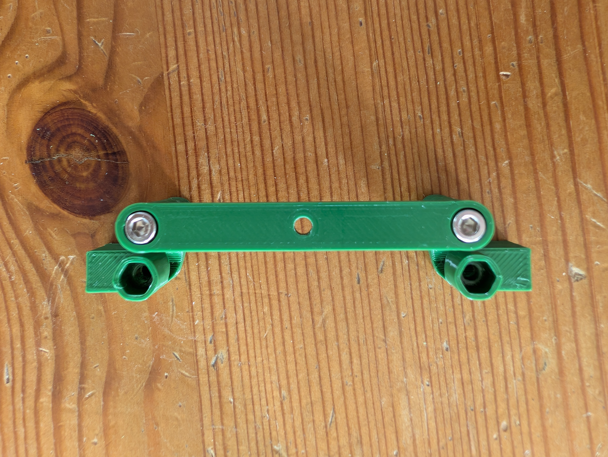 Connect the tie rod to both of the steering arms using M3n nylon lock nuts |
|  Connect the DC Motor Shaft to the DC Motor| 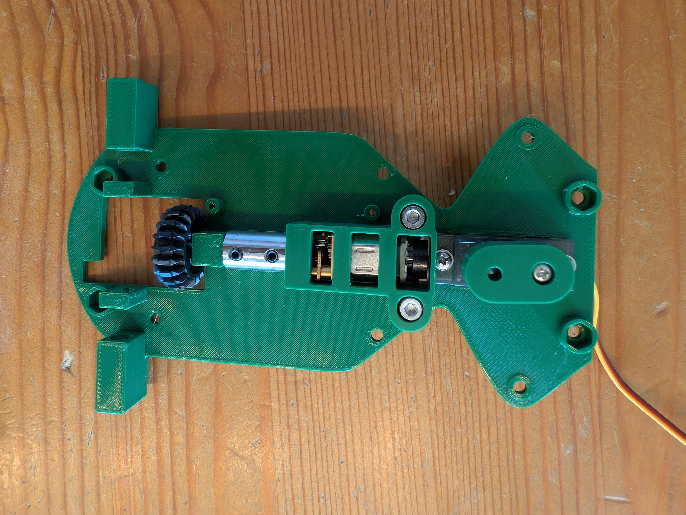 Fix the DC motor onto the first stage using the DC Motor Cover and screw the servo in place|  Prepare the battery holders (2x) |
| 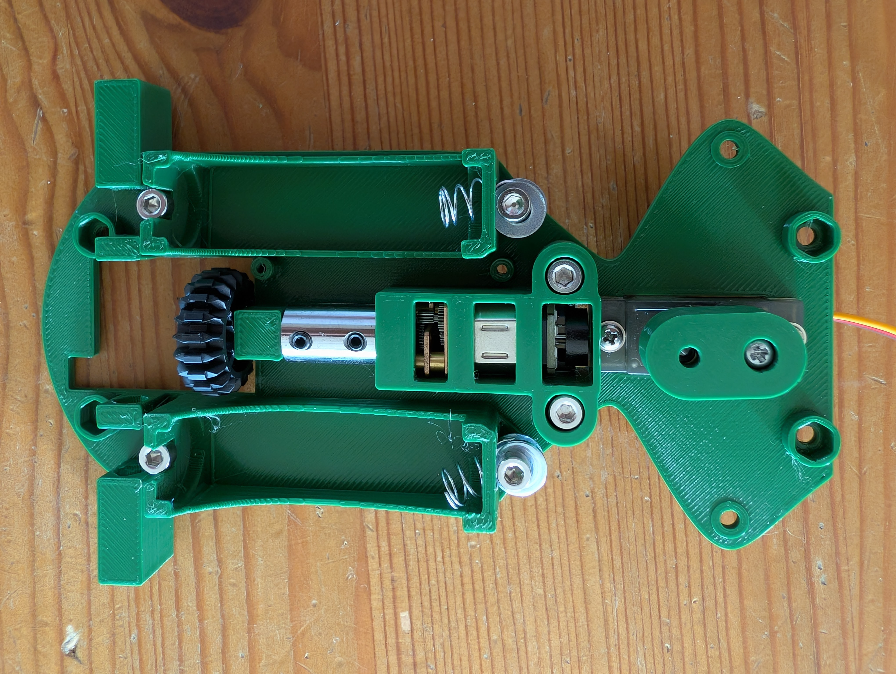 Screw the battery holders onto the first stage |  Connect protruding screws to the wires and screw nut on |  Use M2 screws to fix the motor driver in place and wire everything up (use Wagos for GND and VCC) |
|  Connect the lego gears, axles and wheels | 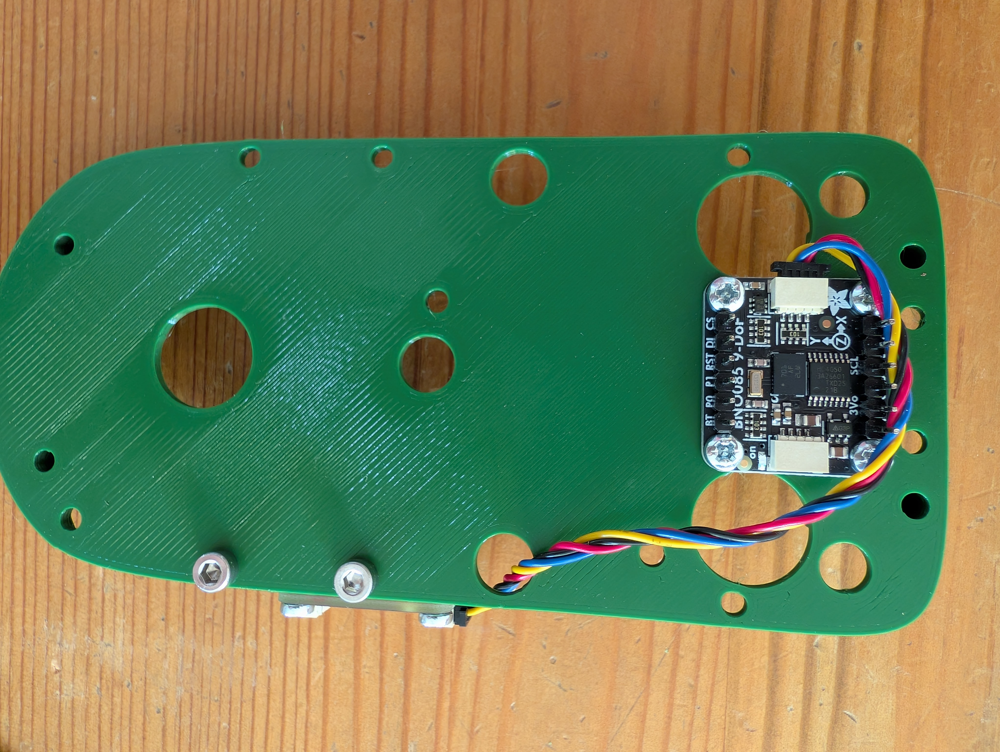 Now fasten the sensors to the Second Stage using M2.5 screws and nuts |  The ToF sensors are mounted via the ToF Mounts that are fastened with M3 screws |
| 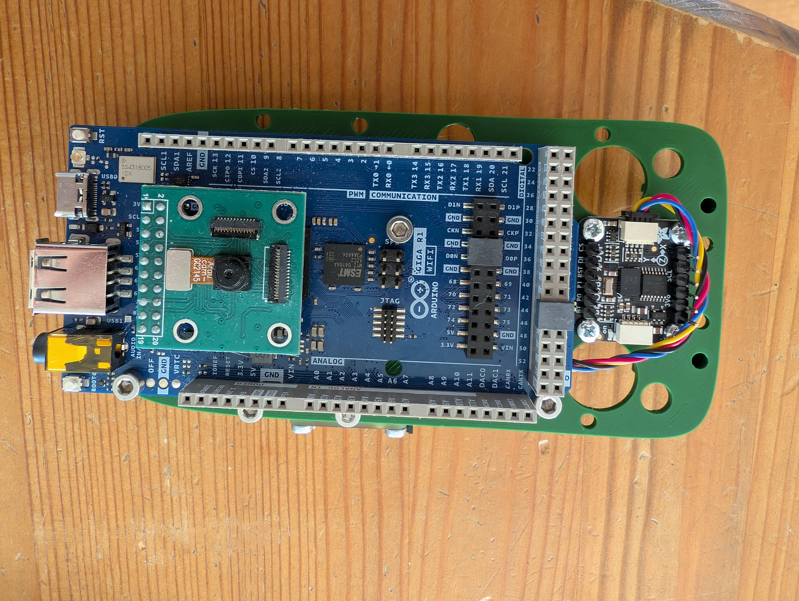 Place the Arduino Giga on top of the Arduino Spacer and fasten with M3 Screws |  Wire the DC-DC-Converter and the Logic Level Shifter according to the schematics |  Thread the wires to the arduino through the Second stage |
|  Screw the second stage onto the first one | | |

# Mechanical Design

## Chassis

The chassis was designed to provide:

- High rigidity: We used screws and nuts to connect all 3D printed parts
- Low centre of gravity: Special attention was given to the placement of heavy components (e.g. Batteries) to maximise stability
- Easy maintenance: No glue and tape (just for electric isolation), electrical connections with jumper wires
- Efficient component placement: Used up almost all space available in our robot
- Easy 3D printability: All printed parts are printable without any supports necessary

### Steering

We used Ackermann steering to enable the robot to turn without the steering wheels slipping. As visible in the following image, the steering was created by drawing a line from the turning point of the Steering Arm to the middle of the back axis.
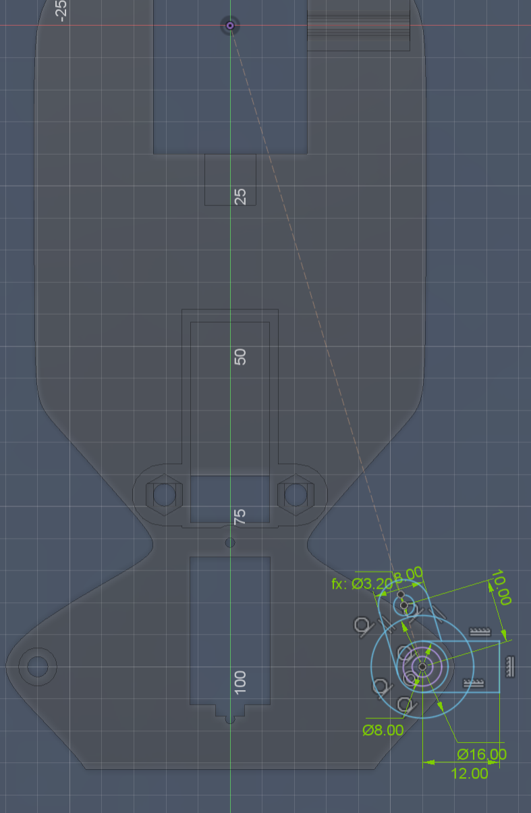

By constructing our own steering mechanism, we could focus on creating a very tight turning radius, so to improve future parking and unparking.

One major difficulty in designing the steering was calculating the exact spacing between servo and base plate. We had to make sure that all the connections between 3D printed parts were parallel so to minimise friction when steering.

## Battery System

### Custom Battery Holders

The initial design used a commercial battery holder. However, during the mechanical integration process, it became clear that mounting a standard dual battery holder underneath the vehicle was difficult and inefficient in terms of space usage.

To solve this problem, we designed and manufactured our own battery holders. The custom design allowed us to mount one holder on each side of the underside of the vehicle, making much better use of the available space.

This arrangement also improved the vehicle's weight distribution by placing the batteries lower and more symmetrically, resulting in a lower center of gravity. In addition, the custom holders make battery replacement faster and more convenient during testing and maintenance.

Overall, the self-designed battery holders provided a more **compact**, **practical** and **competition-ready solution** than the original commercial holders.

# Mobility System

## Drive Motor

We use the [DFRobot 6 V 530 RPM micro gear motor with encoder](https://www.bastelgarage.ch/6v-530rpm-30-1-micro-gear-motor-with-encoder). It has the same base motor type as our earlier drive motor, but a different gearbox. Its 1:30 reduction means the motor shaft turns 30 times for one gearbox-output revolution.

The supplier lists these specifications:

- Rated voltage: 6 V
- No-load gearbox-output speed: 530 RPM
- Gearbox-output speed under load: 300 RPM at 6 V
- Torque: 0.2 kg·cm (approximately 0.02 N·m)
- No-load current: 60 mA; current under load: 170 mA

Our firmware uses `GEAR_RATIO = 30` and counts both edges on both encoder channels, giving 840 counts per gearbox-output revolution (`30 × 7 × 4`). We account for the separate wheel gearing in `include/config.h` when converting encoder counts to travel distance.

### World Final Speed Requirement and Low-Speed Trade-Off

We changed from 100:1 to 30:1 to obtain the higher speed needed for the international World Final. Less reduction increases output speed but reduces torque multiplication, making precise low-speed parking and observation manoeuvres more demanding.

During testing, we observed low-speed surging and chassis shaking. Our former minimum-PWM cutoff switched the motor off whenever the controller requested too little power, then switched it back on as the robot slowed. Battery charge and tyre scrub during steering also affected the effort needed to keep moving, so tests with lifted wheels did not adequately represent driving on the floor.

We introduced pulse-density drive for targets up to 120 mm/s. Short powered slots overcome breakaway friction, while their frequency of occurrence controls average power. We use a 120-PWM carrier with 5 ms slots (200 Hz), encoder-based PI feedback and compensation for steering load. Tuning the pulse strength and integral response improved speed tracking without the excessive noise and overspeed of our earlier settings.

Earlier tests improved average low-speed tracking, although speed ripple and chassis shaking remain validation concerns. Those mean-speed results do not establish smooth operation of the current robot under every load and battery condition. The faster gearbox represents a compromise between driving speed and smooth creeping motion.

<!-- TODO: Revalidate the current 30:1 drivetrain at low speeds in forward and
reverse, straight and full-lock, with charged and lower-voltage packs. Record
mean speed, speed ripple, shaking/noise, stalls, stopping behaviour and current
consumption. Do not treat the earlier mean-speed passes as proof that the
currently reported low-speed problems are resolved. See DOCUMENTATION_TODO.md. -->

### Earlier Motor Selection

Before choosing the current 30:1 gearbox, we tested both 50:1 and 100:1 versions on the robot. The specifications below describe those earlier prototypes.

#### Option 1 — 50:1 Gearbox

- Output speed: 310 RPM
- Torque: 0.35 kg·cm

We tried this version for its higher speed, but its lower torque made driving under load less consistent.

#### Option 2 — 100:1 Gearbox

- Output speed: 155 RPM
- Torque: 0.70 kg·cm

This version provided more torque and more consistent driving, although its maximum speed was lower.

#### Testing Results and Initial Decision

We initially selected the 100:1 gearbox after comparing both versions under realistic driving conditions. For the international World Final, we subsequently changed to 30:1 to gain more speed, with the low-speed control trade-off described above.

# Steering System

## Initial Prototype

The first steering design used a very small micro servo because we wanted to be as space-saving as possible.

Problems observed:

- Insufficient steering force
- Inconsistent wheel positioning

## Final Solution

### TowerPro MG90S Metal Gear Servo

The MG90S was selected because it provides:

- Higher torque
- Metal gears
- Better durability
- More accurate steering

The larger servo improved steering repeatability under load at the cost of additional mounting space.

# Power Budget

## Power System Overview

The robot carries two 14500 Li-Ion cells wired in series. This creates a 2S pack with a nominal voltage of 7.4 V (8.4 V when fully charged). We own four cells in total: one matched pair is used in the robot while the second pair is charged or kept ready as a spare. Connecting cells in series increases voltage while the pack capacity remains the capacity of one cell.

### Estimated Current Consumption

The values below are component-level estimates, not measured battery current. Components operate on different supply rails, so their current sum does not account for conversion efficiency or establish pack runtime.

| Component | Typical Current |
|------------|------------|
| Arduino GIGA R1 WiFi | 200 mA |
| BNO085 IMU | 15 mA |
| VL53L4CX ToF Sensor #1 | 40 mA |
| VL53L4CX ToF Sensor #2 | 40 mA |
| Rear VL53L4CX ToF Sensor | 40 mA |
| Arducam BO462 Camera | 120 mA |
| MG90S Servo (average) | 250 mA |
| Drive Motor | 300 mA |
| MC33926 Motor Driver | 10 mA |
| LM2596S-5 DC-DC Converter | 5 mA |
| TXS0104E Logic Level Converter | 2 mA |
| Voltage Display | 20 mA |
| **Sum of listed component currents** | **1042 mA** |

### Peak Current Consumption

During acceleration, steering corrections and obstacle avoidance, the motor and servo can draw significantly more current.

| Component | Peak Current |
|------------|------------|
| Drive Motor | 800 mA |
| MG90S Servo | 700 mA |
| Remaining Electronics | 492 mA |
| **Sum of estimated component peaks** | **≈ 2.0 A** |

Regulator output current and battery-side peak current still require measurement on the finished wiring.

# Electronics Architecture

<!-- TODO: After the final wiring is frozen, expand the explanation of each
electronic component, especially the logic-level converter, DC-DC converter and
voltage display. The authoritative task is tracked in DOCUMENTATION_TODO.md. -->

## Main Controller

### Arduino GIGA R1 WiFi

The Arduino GIGA R1 WiFi acts as the central controller. We use both of its processor cores so that rear distance sensing cannot delay the main navigation and camera loop.

Reasons for selection:

- High processing power
- Large memory capacity
- Multiple communication interfaces
- Excellent expandability

The M7 core manages:

- Camera capture and image processing
- Two side-ToF sensors and IMU communication
- Navigation algorithms
- Steering control
- Motor control

The M4 core owns the rear VL53L4CX through a dedicated 100 kHz software-I2C bus: A3 is SDA and A4 is SCL. It filters measurements and sends fixed-size status frames to the M7 over OpenAMP/RPC. If the M4 or rear sensor stops responding, the M7 marks the reading unavailable instead of waiting indefinitely in the control loop.

All three hardware-I2C ports were already in use: one for each side ToF sensor and the third for the camera's configuration connection. Adding the rear ToF to a shared port would require extra sensor-selection and startup sequencing, because the ToF sensors initially use the same address. We would have to enable them separately and assign different addresses, then handle possible address conflicts after a sensor reset. To avoid this additional wiring and shared-bus complexity, we chose a separate software-I2C bus for the rear sensor and assigned its communication and measurement processing to M4.

We use the second core to isolate sensor communication from time-sensitive motion control. Software-I2C generates the bus signals in software, and reading a measurement requires several synchronous transactions. Running those transactions on M7 would add work and variable delays to the same loop that processes camera images, estimates position and updates motor and steering commands. M4 instead handles rear-sensor initialization, readiness polling, measurement retrieval and filtering independently. M7 reads the latest published result rather than waiting for a new measurement, so adding the rear sensor does not add its individual bus transactions to the navigation loop.

This separation also makes failures explicit. Frames carry a sequence number and sensor status; missing or stale frames and initialization/bus failures make the rear reading unavailable. The parking controller can stop instead of treating an old distance as current. The benefit is predictable control-loop timing and independent sensor servicing, not a faster optical measurement: the rear sensor still uses its own 30 ms timing budget. The side sensors remain on M7, and the rear bus has a single owner, avoiding competing access from both cores.

# Sensor Architecture

## BNO085 IMU

### Purpose

The BNO085 was selected because of its high accuracy, low drift and reliable sensor fusion capabilities. During development, several orientation measurement methods were evaluated to determine which provided the most consistent results for autonomous navigation.

### Usage

The firmware requests the BNO085 game rotation vector at 100 Hz and uses its yaw for heading estimation and turn control. This fused orientation report uses the gyroscope and accelerometer without a magnetometer reference. Encoder distance supplies translational motion for the position estimate.

The magnetometer was also evaluated but was ultimately not used. We observed significant heading drift and instability, most likely caused by magnetic interference from the motor, wiring and other electronic components inside the vehicle.

We do not integrate raw accelerometer readings into position or speed. The accelerometer still contributes internally to the game rotation vector; the motor encoder provides movement feedback.

By focusing on the gyroscope data, we achieved accurate turn control while avoiding the limitations of the other sensors in our specific robot design.

# Distance Sensors

## Selection and Design Evolution

We use three Adafruit VL53L4CX Time-of-Flight (ToF) modules. Our original VL53L3CX modules worked, but required directly soldered wiring; damaging one during soldering exposed a maintenance risk. The replacement modules offer improved range and signal performance, while Qwiic/STEMMA QT connectors simplify cable routing and allow replacement without soldering. We therefore chose them for both sensing performance and serviceability.

## Placement and Roles

- **Left and right:** Side-facing sensors measure wall distance and obstacle clearance. This arrangement supports either track direction and provides wall-following and wall-loss evidence in the Open Challenge.
- **Rear:** A rear-facing sensor measures the magenta parking boundary during parking-exit positioning. It is mounted 25 mm behind the rear axle, so we account for its offset when converting sensor range into body clearance. M4 handles this sensor independently, as explained in the controller section.

## Measurement Timing and Filtering

We poll the side sensors asynchronously with a normal 30 ms timing budget. Initial direction discovery uses 300 ms to improve returns from dark walls at the cost of slower updates; the switching logic is described in the Open Challenge section.

The software checks hardware status, signal strength and measurement uncertainty, then selects the furthest acceptable return. Configured range limits are 600 mm for normal side sensing and 370 mm for the rear sensor; these are control limits, not the sensor's advertised maximum range. Side readings beyond the active limit are marked out of range (`9999`).

We clamp changes between consecutive valid, in-range side-sensor control values to 100 mm to reduce abrupt steering corrections from noise or target switching. For example, a 500 mm reading after a filtered 250 mm value produces 350 mm. Invalid previous readings and transitions to or from out of range bypass the limiter, preserving gap detection and reacquisition. The trade-off is delayed response to genuine large in-range changes; this filter is not a clearance requirement or collision guarantee.

## Parking Calibration and Verification

The rear sensor sits 15 mm ahead of the back of the robot, so its 65 mm target corresponds to 50 mm body clearance from the inside face of the magenta parking piece. Before allowing the parking exit to start, we require three fresh stationary samples spanning no more than 4 mm, a final range within 5 mm of the target, and agreement between ToF-measured movement and encoder travel within 8 mm. These checks prevent a single unstable reading or drivetrain take-up from defining the starting position. Parking tests and the resulting adjustments are summarized in the engineering testing section.

## Wall Edges and Detection Limits

The sensor observes a cone rather than a single ray: it may still see the old wall after its centreline passes an edge, or detect a perpendicular wall obliquely. [ST's datasheet](https://www.st.com/resource/en/datasheet/vl53l4cx.pdf) reports an approximately 18–22 degree detection angle under specified conditions; actual coverage depends on the surface, lighting and configuration. Wall loss therefore does not mark the exact geometric corner.

An out-of-range return bypasses the 100 mm clamp, while a valid return from another surface remains subject to it. In the Open Challenge, we combine wall-distance evidence with encoder travel and gyro heading rather than treating the ToF transition alone as the corner position.

<!-- TODO: Measure the actual wall-loss position and any perpendicular-wall
returns on the competition-like black walls in both directions, at the intended
wall distances and speeds. Compare raw and filtered ranges with encoder travel
and heading; do not assume the centreline crossing is the detection point. -->

# Camera System

## Arducam BO462

The Arducam BO462 was selected as the camera for our vehicle because it is specifically designed for use with the Arduino GIGA R1 WiFi. In addition, extensive documentation, examples and community resources are available online, making development and troubleshooting easier.

### Purpose

The camera is used for real-time red and green traffic-sign detection. Its main task is to identify the coloured pillars, estimate their bearing and distance, and associate them with legal field seats rather than capture highly detailed images.

### Advantages

- Designed for the Arduino GIGA R1 WiFi
- Well documented with many online examples
- Full-width field of view for observing both sides of a station
- Low image resolution reduces processing requirements
- Suitable for real-time object and colour detection
- Continuous DMA capture keeps image acquisition separate from navigation

The relatively low resolution is an advantage for our application because it reduces the amount of data that must be processed by the microcontroller. Our tested GC2145 configuration uses a 24 MHz external clock with input divide-by-two, preserving the nominal internal timing of a 12 MHz input without that divider. This clock setting provides no demonstrated frame-rate advantage. Continuous DCMI capture alternates between two SDRAM buffers: DMA fills one buffer while the M7 processes the other.

### Challenges

**Blocking image acquisition.** The original camera library's synchronous `grabFrame()` waited for acquisition before navigation could continue. Capture plus image processing blocked the M7 loop for roughly 149 ms per result, leaving motion control without timely updates. We introduced a project-owned driver with asynchronous DCMI/DMA capture and two frame buffers in external SDRAM. DMA fills one buffer while vision processes the completed other buffer, reducing control-loop blockage to approximately 6.5–7.6 ms per result. Keeping the buffers outside internal RAM also leaves more room for the controller's stacks and other allocations. Explicit buffer ownership and M7 cache invalidation prevent vision from reading a partly written or stale image.

**Missed frames during snapshot restart.** Asynchronous snapshots removed the blocking wait, but stopping and restarting capture sometimes missed the next sensor frame boundary. Instead of the normal approximately 79.62 ms interval, some updates arrived after approximately 159.25 ms. Exposure diagnostics showed that these doubled intervals were restart misses, not longer exposure in dark lighting. We changed to uninterrupted continuous DCMI capture with DMA double buffering. Interrupts publish completion information; cache handling and image processing remain outside the interrupt. This removed the doubled intervals in the recorded acceptance tests without reducing exposure and weakening dark-scene detection.

**Field of view and distance estimation.** The earlier centred-crop image did not preserve the full optical view, reducing the opportunity to observe pillars at the sides of a station. We configured the GC2145 to subsample the full 1616 × 1208 sensor window into a 320 × 240 image, retaining the wider view without transferring a large high-resolution frame. We then recalibrated horizontal field of view, principal point and focal length using known pillar placements. Bounding-box height was unsuitable for range estimation because the obstacle region can clip the pillar's top. A calibrated ground-plane model instead estimates range from the visible foot of the pillar. Full-view measurements also showed that the earlier crop-specific off-axis correction overcorrected distances, so that correction was removed.

**Unreliable clock changes and lighting bands.** Our faster-clock experiments initially produced displaced or fragmented pillar images. Enabling input divide-by-two at 24 MHz restored the proven internal and pixel-stream timing. Increasing the internal PLL speed still caused lighting bands and partial or missing pillars despite anti-flicker adjustments, so we rejected that profile. We retained 24 MHz with the divider because it passed our tests, not because it outperformed 12 MHz without the divider. Continuous capture removed missed-frame delays; a later reduction in idle vertical blanking shortened the frame interval slightly further, from approximately 79.6 ms to 76.5 ms.

<!-- TODO: If reverting to 12 MHz without the input divider, compare the current
full-FOV configuration under varied lighting and motion before claiming
equivalent reliability. No performance benefit from 24 MHz itself has been
demonstrated. -->

**Reliable colour and seat confirmation.** Small coloured background blobs or a single noisy classification must not immediately change the robot's route. We calibrate HSV colour thresholds and valid blob geometry, transform accepted detections into the fixed field frame, and associate them with legal pillar seats. Consecutive colour votes are required before the route changes. A wider optical view alone does not guarantee usable evidence: the complete pillar must remain in the calibrated range and angle window long enough for independent frames.

<!-- TODO: Validate the camera calibration under competition-like lighting and
add the measured detection and reliability results. See DOCUMENTATION_TODO.md. -->

In a stationary reliability test under the available indoor lighting, both official pillar colours remained production-valid for 2025 of 2025 processed frames. Frame completion stayed at approximately 79.62-79.63 ms with no discarded frames or DMA/DCMI errors. Vision processing occupied approximately 6.5-7.6 ms of the main loop instead of the roughly 149 ms required by the earlier synchronous capture path. A subsequent 175 mm/s single-red-pillar driving test completed without contact.

# Wiring Diagram

The diagram below shows the earlier wiring. The current robot also has a rear VL53L4CX connected to M4's software-I2C bus (SDA A3, SCL A4); the side sensors remain on M7. Rear measurements reach M7 through on-board OpenAMP/RPC, without an additional external signal cable between the cores. The diagram still needs to be updated for this sensor and the final power connections.

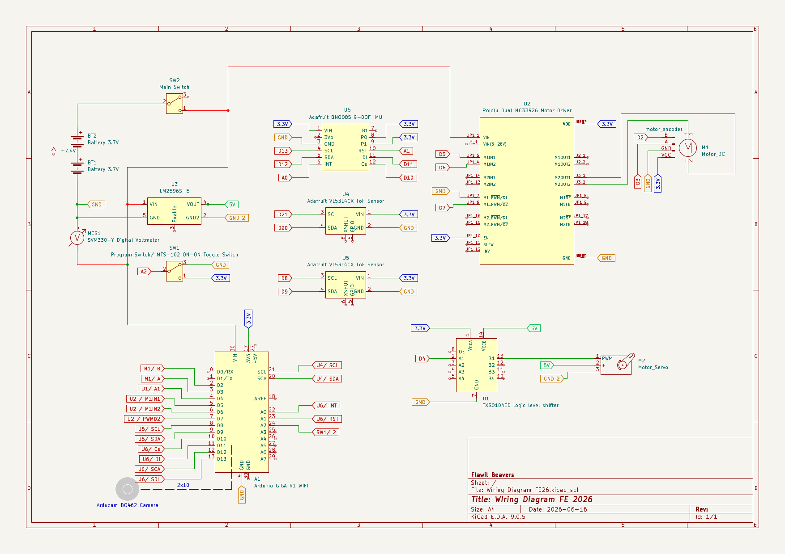

The BOM includes an LM2596S-5 regulator, a TXS0104E level converter and a voltage display. Their final supply rails, signal connections and regulator loading need to be reconciled with the physical wiring before this diagram can serve as a complete build reference.

# Software Architecture

The software is built as a modular, non-blocking control system for the dual-core Arduino GIGA R1 WiFi. The M7 runs the time-critical navigation, motor, steering, IMU, side-ToF and camera tasks. The M4 independently samples the rear ToF sensor and transfers filtered status frames to the M7. This separation keeps a slow or missing rear measurement from delaying steering or image processing.

```text
Arduino GIGA R1 WiFi
|
+-- M7: main.cpp and mode_manager.cpp
|   +-- sensors.cpp ............... BNO085 and two side VL53L4CX sensors
|   +-- camera/vision ............. continuous GC2145 capture and colour blobs
|   +-- motor_control.cpp ......... encoder speed PI, PWM and steering servo
|   +-- navigation_controller.cpp  Open Challenge wall following
|   +-- obstacle_path.cpp ......... field map, seat voting and Pure Pursuit
|   +-- final_parking.cpp ......... parking scan, path execution and verification
|   +-- logger/serial_handler ..... telemetry, test modes and stored run logs
|
+-- M4: rear_tof_m4.cpp
    +-- software I2C on A3/A4
    +-- filtering and M7 status transfer through OpenAMP/RPC
```

The central mode manager ensures that only one autonomous or calibration mode owns the actuators at a time. The physical enable switch can pause a mode immediately, while the selected mode is remembered for a controlled restart. Calibration and diagnostic modes use the same production sensor and motor interfaces, so results transfer directly into the competition software.

### Main implementation principles

- **Non-blocking updates:** Sensor readiness, camera frames and controller states are checked during every loop instead of using long delays.
- **Closed-loop motion:** Encoder feedback regulates speed and the gyro verifies heading. Low-speed pulse-density control supplies enough breakaway torque without forcing excessive average power.
- **Fixed field coordinates:** Encoder distance and gyro heading form a dead-reckoning pose. Trusted wall and parking-piece observations apply bounded corrections without changing the field frame.
- **Fail-safe decisions:** Sensor freshness, travel, timeout, wall clearance, steering and path-feasibility gates stop the robot when evidence is insufficient.
- **Reproducible telemetry:** Important decisions include pose, sensor quality, selected seat, path clearance and controller result in the USB run log.

# Navigation Strategy

## Open Challenge

The Open Challenge uses a **hybrid gyro-stabilized wall-following strategy**. It is intentionally simpler than the Obstacle Challenge path planner because no traffic signs need to be mapped. The robot follows one wall at a 300 mm target distance, maintains headings on the 0, 90, 180 and 270 degree grid, counts four corners per lap and stops after twelve turns (three laps).

### Geometric correction

The controller estimates the **perpendicular distance** to the wall from the sensor range and gyro heading error:

$$
d_{perp} = d_{raw} \cdot \cos(\theta_{error})
$$

This prevents "phantom distance" increases when the robot is tilted relative to the wall, which is critical for stable PD control.

### Combined control law

The steering output is the sum of two PD (Proportional-Derivative) controllers:

- **Primary Control:** Gyroscope-based PD maintains a global grid heading (0°, 90°, 180°, 270°).
- **Secondary Control:** ToF-based PD corrects distance error around the 300 mm target.

At the start, while `nav_following_wall == SIDE_UNKNOWN`, the controller selects a 300 ms side-ToF timing budget for long-range discovery of the track direction. As soon as it determines which side to follow, it restores the normal 30 ms budget before the first turn. Subsequent wall following, gyro-controlled 90 degree turns and wall reacquisition all retain the 30 ms budget; losing the wall at a later corner does not make the followed side unknown again. Encoder feedback keeps the requested speed consistent as battery voltage and steering load change.

## Obstacle Challenge

The Obstacle Challenge uses a known field model, camera observations and **Pure Pursuit** trajectory tracking. A baseline route is sampled every 50 mm in a fixed coordinate frame. The position estimator integrates rear-wheel encoder distance with gyro heading; side-ToF observations can apply small bounded wall corrections.

### Traffic-sign perception and route generation

1. The camera segments red and green blobs using calibrated HSV and shape limits.
2. Blob position is converted to a bearing and ground-plane range from the camera calibration.
3. The observation is transformed into field coordinates and snapped to a legal traffic-sign seat.
4. Consecutive votes confirm the seat and colour; isolated or geometrically impossible blobs are rejected.
5. The route is locally displaced so that red pillars are passed on the robot's left (robot drives to their right) and green pillars are passed on the robot's right (robot drives to their left).
6. A smooth taper returns the path to the normal lane. Adjacent extreme pillars use staged clearances so one avoidance does not compromise the next.

Pure Pursuit converts the selected lookahead point into curvature and an Ackermann steering request. Lookahead and speed adapt to the route section. Before and during motion, the software checks steering reachability, wall and pillar envelopes, cross-track error, sensor freshness and progress. The first lap discovers the layout; the confirmed seat map is then used to build a smoother route for laps two and three.

When a required seat remains unresolved, the controller can brake, collect fresh frames and evaluate bounded observation paths from the measured pose. Each new motion needs a fresh path check. The current CCW first-lap correction permits additional target aiming only after the protected pillar bypass, with a checked steering arc; it does not increase the steering limit. Invalid pose, substantial deviation and sensor or motion faults still cause a stop. See the [first-lap view report](simulation/LAP1_CHECKED_CCW_VIEW_20261111.md).

### Modified-sign recognition

`OBSTACLE_SURPRISE_RULE_ENABLED` currently defaults to `1`. The implementation estimates pillar height from the visible top and ground contact, requires three independent confirming frames, and stores the selected seat's inferred original colour for route generation on all three laps. Visible colour remains available for diagnostics. This setting is separate from `O3`, which changes which stations are inspected.

The [implementation report](simulation/SURPRISE_RULE_IMPLEMENTATION_20261111.md) records model checks and the [rules reference](WRO_2026_RULES.md) links the official task. Real 50 mm and 150 mm pillars have not yet been accepted with the mounted camera; the approved normal-height reference does not establish that capability.

### Starting from the parking lot

The parking lot is 200 mm deep and `1.5 * robot length` long, giving 247.5 mm for the current 165 mm robot. Before moving, the rear ToF normalises the longitudinal start to 50 mm rear-body clearance. The robot then executes a five-segment Ackermann exit whose swept footprint was checked against both magenta pieces and placement tolerances. The last arc ends from gyro feedback when the robot is parallel instead of trusting a fixed theoretical travel distance.

After the exit, side-ToF measurements of the magenta piece and a bounded reverse edge crossing correct the field pose. A camera scan resolves the starting-section seats. If the normal scan cannot see a required seat, a short preflight-checked scout and return creates a second view. A finite Pure Pursuit connector then merges the measured pose into the normal lap route without jumping to an unrelated point on the cyclic path.

### Final parking

After three laps, the final-parking controller approaches the parking section from the established field frame. It scans across the fixed and movable magenta pieces, measures their inside faces, checks their separation against the configured bay size and constructs the bay coordinate frame. The normal entry uses a mirrored seven-segment sequence. Measured curvature and stopping behaviour can trigger replanning; a bounded multi-point search is available when the short candidates fail.

Completion requires a stationary, parallel pose with straight wheels and the complete measured footprint inside the bay. The robot can stop at a valid contained pose without making an unnecessary longitudinal centring move. The planner checks steering-dependent wheel reach and the swept path in both driving directions.

The latest [parking recheck](simulation/LAP1_PARKING_RECHECK_20261111.md) passed 96 of 120 approach-model cases. All 24 remaining aborts occurred at a 232.5 mm measured gap within the accepted measurement range. These are model results; they do not establish physical parking reliability. The [original log index](simulation/evidence/parking_exit_diagnostics/README.md) and [physical reports](simulation/RETURNED_651_656_PARKING_20261105.md) retain the separate real-run outcomes.

# State Machine

The Open Challenge follows the compact navigation state machine below:

```text
NAV_IDLE
   |
   v
NAV_FOLLOWING -- corner detected --> NAV_TURNING
   ^                                  |
   +----------------------------------+
   |
   +-- after 12 turns --> NAV_STOPPED
```

The Obstacle Challenge adds perception, mapping and parking phases around the shared motor, gyro and safety controllers:

```text
Rear-ToF start positioning
        |
Five-segment parking exit
        |
Magenta-edge localisation and camera scan/scout
        |
Preflight-checked connector to the lap route
        |
Pure Pursuit lap 1: discover, vote and inject pillar routes
        |
Pure Pursuit laps 2-3: follow the confirmed optimized map
        |
Final approach, bay scan, checked entry/recovery and verification
        |
Controlled hold (or immediate safe abort from any failed gate)
```

# Engineering Testing and Iteration

The development process follows a repeated **plan - build - test - analyse - improve** cycle. Simulation predictions are kept separate from physical observations, and a contact or manual intervention is always treated as a failed run even if telemetry reaches its nominal endpoint.

| Subsystem | Test evidence | Decision or improvement |
|---|---|---|
| Steering geometry | Physical turning-radius measurements across practical steering angles gave approximately 2.35% mean prediction error after compensating a +0.6 degree servo-neutral offset. | Use measured Ackermann geometry and gyro-bounded final alignment instead of relying only on CAD angles. See [Ackermann calibration](CAD/ACKERMANN_KINEMATICS_DOCUMENTATION.md). |
| Low-speed drive | Earlier tests improved mean speed from 59.4 to 71.0 mm/s at an 80 mm/s target; 60 mm/s straight/full-lock cases met the +/-10 mm/s mean tolerance. These averages do not establish acceptable speed ripple, noise or stall behaviour on the current robot. | Retain the 120 PWM, 200 Hz pulse-density carrier and speed PI; keep loaded forward/reverse validation across battery conditions open. |
| Camera pipeline | Both official colours were valid in 2025/2025 consecutive frames, with 79.62-79.63 ms frame intervals and no DMA errors. | Keep continuous double-buffer capture and the tested 24 MHz input-divider profile, which preserves rather than increases internal speed; reject the faster PLL profile that produced lighting bands. |
| Parking exit | The five-segment physical exit completed without contact. Gyro-controlled final alignment stopped after 162.6 mm with 0.9 degree final heading error. | Replace a fixed-distance final turn with bounded heading feedback and preserve swept-envelope preflight checks. See [parking-exit validation](simulation/PARKING_EXIT_PATH_SIMULATION.md). |
| Rear parking reference | A 7.16 V test corrected rear range from 46.3 to 60.7 mm and passed the 5 mm canonical tolerance and encoder/ToF agreement gates. Consecutive mirrored runs also completed without contact. | Use stationary multi-sample verification and a bounded micro-correction rather than accepting one noisy reading. |
| Obstacle route | Physical runs demonstrated camera-controlled single-pillar avoidance, complete laps in both directions and three-lap execution. Later difficult adjacent-pillar and parking-entry cases were retained as regression evidence. | Build the first-lap route from live seat evidence, use a confirmed map for later laps, and stop safely when a seat or connector cannot be proven. |
| Final parking | November 5 runs 655/656 were reported nearly perfect CCW; CW 651 had poor/incomplete physical parking despite estimated completion, and 654 aborted during replanning. Later approach-model checks passed 96/120, with all failures at a 232.5 mm gap. | Use the measured steering envelope and verified containment; preserve the narrow-gap limitation and distinguish estimated completion from physical acceptance. |
| Modified-sign height | Synthetic height/association checks pass, but approved real evidence covers a normal-height pillar only. | Keep real 50/150 mm height recognition unvalidated until accepted mounted-camera evidence is available. |

These records cover different firmware revisions. The archived physical runs predate the November 11 perception and parking changes, so they are historical demonstrations rather than acceptance of the current source. The [current handoff](AGENT_DOCUMENTATION.md) identifies revisions and validation limits; complete logs and hashes are in the [evidence index](simulation/evidence/parking_exit_diagnostics/README.md).

These tests also exposed interactions between subsystems. Lower battery voltage increased drivetrain breakaway effort; steering load changed motor speed; camera timing affected control-loop availability; and parking accuracy depended on the robot footprint, Ackermann radius, encoder stopping distance, ToF geometry and gyro error together. The software therefore records these quantities in the same run instead of evaluating each component in isolation.

# Build, Upload and Operation

The complete firmware is stored in this repository as a PlatformIO project. Install Visual Studio Code with the PlatformIO extension, clone the repository and open its root folder. The two environments in `platformio.ini` target the two GIGA cores.

Build both images from PowerShell with the IDE-managed PlatformIO Core:

```powershell
$pio = Join-Path $env:USERPROFILE '.platformio\penv\Scripts\platformio.exe'
& $pio run --environment giga_r1_m4
& $pio run --environment giga_r1_m7
```

These two builds are needed for an initial complete installation. For later changes, build only the affected core; rebuild both when a shared interface or protocol changes. Run commands from the repository root to reuse the existing PlatformIO cache and incremental build output.

For a complete installation, upload the rear-sensor M4 image first and the main M7 image second:

```powershell
$pio = Join-Path $env:USERPROFILE '.platformio\penv\Scripts\platformio.exe'
& $pio run --environment giga_r1_m4 --target upload
& $pio run --environment giga_r1_m7 --target upload
```

The serial monitor runs at 115200 baud. `STARTUP_ROBOT_MODE` in `include/config.h` selects the competition mode; the current configuration starts the Obstacle Challenge. Set it to `MODE_OPEN_CHALLENGE` for the Open Challenge and rebuild M7. The power switch supplies the robot, while the separate enable/start switch begins or pauses the selected program without requiring a computer or phone on the competition field.

The startup and run-stage switches are grouped at the top of `include/config.h`. For the current Obstacle setup, leave `STARTUP_ROBOT_MODE=MODE_OBSTACLE_CHALLENGE`, set the enable switch LOW, power on, wait for the blue ready light, then enable the robot. The current configuration performs parking exit, three laps and a final-parking attempt: `OBSTACLE_FIRST_LAP_TEST_ENABLED`, `OBSTACLE_THREE_LAP_TEST_ENABLED` and `OBSTACLE_FINAL_PARKING_TEST_ONLY` are all false, and final entry is armed. Although `OBSTACLE_PARKING_EXIT_TEST_ONLY` is true, enabled entry discovery makes the current run continue after the exit.

`OBSTACLE_STARTUP_CHECK_ALL_STATIONS=true` requests inspection of every station after rebuilding M7. Alternatively, serial `O3` selects that inspection layout while disabled for the current power cycle; `O` selects the official layout and lowercase `l` selects Open Challenge. Neither `O` nor `O3` changes modified-sign participation: set `OBSTACLE_SURPRISE_RULE_ENABLED` before building to match the declared attempt. The separate `include/parking_exit_diagnostics_config.h` controls parking-exit logging. Header changes require rebuilding and uploading the affected image.

Dedicated modes are provided for servo centre, turn radius, motor minimum drive, speed PI, ToF diagnostics, camera colour/distance calibration and isolated obstacle-path tests. Their results are applied through `include/config.h`, and the same production code paths are then used by the challenge modes.

# Video

## Open Challenge

[](https://www.youtube.com/watch?v=koMCLdpg0-I)

## Obstacle Challenge

[](https://www.youtube.com/watch?v=5dCMkFn-6TI)

# Robot Photos

<!-- TODO: Replace these photographs after the robot is frozen so every final
component and wiring change is visible. See
DOCUMENTATION_TODO.md. -->

These June 2026 photographs show the earlier robot. The current robot includes the rear-ToF sensor described above; replacement robot photographs will be added by the team. The supplied 2026 team photograph appears in [Team Members](#team-members).

| 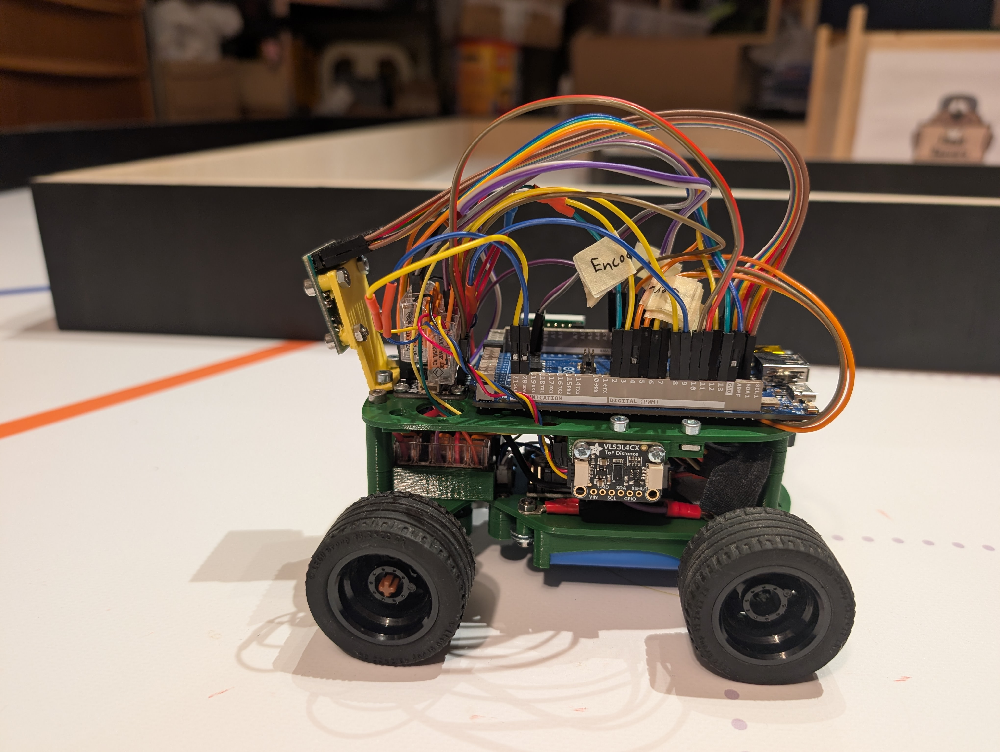 |  | 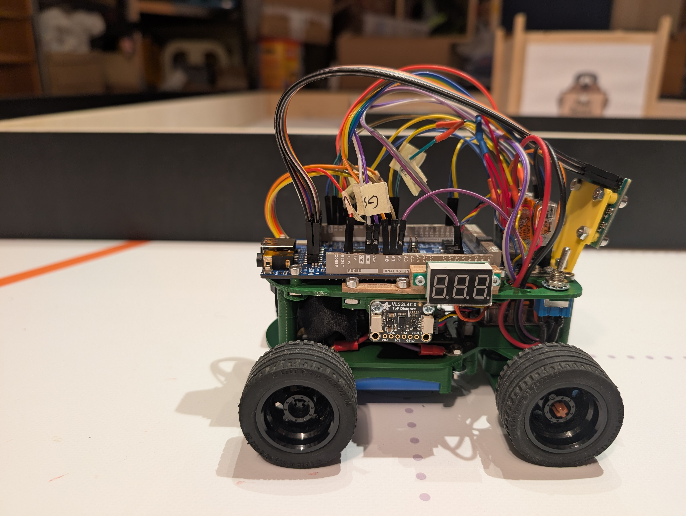 |
|---|---|---|
|  | 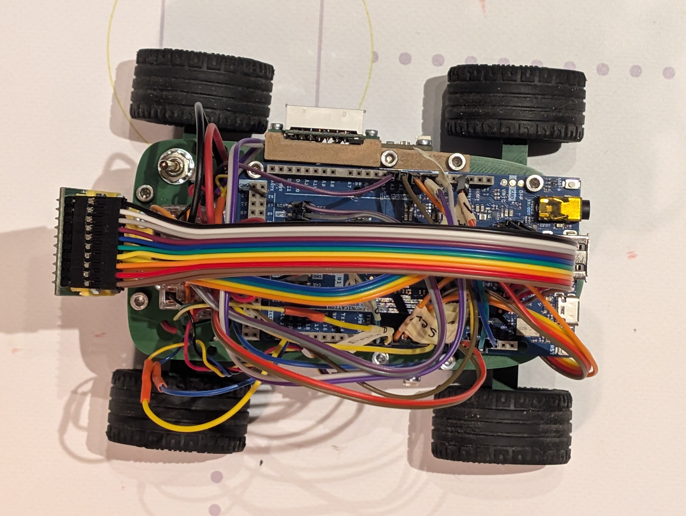 | 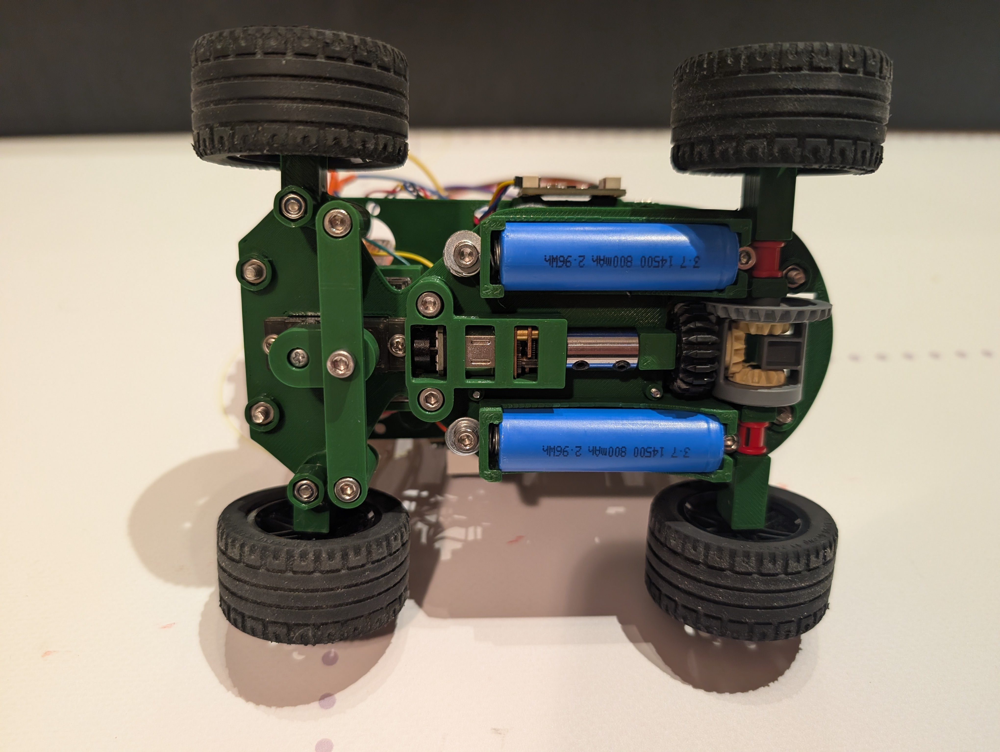 |

# Failure Mode Analysis

## Failure Mode 1 – Insufficient Steering Servo Torque

### Problem

The first steering prototype used a very small micro servo. While it was lightweight and compact, it struggled to control the steering mechanism reliably during driving.

### Observed Issues

- Inconsistent steering angles
- Reduced steering precision
- Steering position changed under load

### Root Cause

The servo did not provide enough torque for the steering system, especially during quick direction changes and when friction forces acted on the wheels.

### Solution

Several servos were evaluated and compared. The original servo was replaced with a TowerPro MG90S metal gear servo, which provided significantly higher torque and a more robust gear train.

### Result

- More accurate steering
- Improved repeatability
- Better control during turns
- Increased mechanical durability

## Failure Mode 2 – Battery Holder Integration

### Problem

The original design used a commercial battery holder. Integrating it into the chassis proved difficult because it occupied valuable space underneath the vehicle and limited the placement options.

### Observed Issues

- Inefficient use of space
- Less favourable weight distribution
- Batteries were more difficult to access

### Root Cause

The commercial holder was not designed for the geometry and packaging requirements of the robot.

### Solution

The team designed and manufactured two custom 3D-printed battery holders. This allowed one battery to be mounted on each side of the underside of the chassis.

### Result

- Better use of available space
- Improved weight distribution
- Lower centre of gravity
- Faster battery replacement
- Cleaner chassis integration

## Failure Mode 3 – ToF Sensor Damage During Assembly

### Problem

The initial design used VL53L3CX Time-of-Flight sensors that required direct soldering.

### Observed Issues

- One sensor was damaged during assembly
- Sensor replacement was time-consuming
- Maintenance became more difficult

### Root Cause

The small sensor boards required delicate soldering work, increasing the risk of accidental damage.

### Solution

The sensors were replaced with Adafruit VL53L4CX modules. These offered improved range, stronger signal performance and support for Qwiic/STEMMA QT connectors.

### Result

- No direct soldering required
- Faster replacement process
- Improved reliability
- Cleaner wiring
- Easier maintenance

## Failure Mode 4 – Drive Motor Selection

### Problem

Two different drive motors were evaluated during development.

### Observed Issues

The 310 RPM motor provided higher speed but showed less consistent driving behaviour.

### Root Cause

The motor prioritised speed over torque, making precise speed control and obstacle avoidance more difficult.

### Solution

Both motors were tested on the vehicle under realistic conditions. After comparing acceleration, controllability and consistency, the 155 RPM motor with a 100:1 gearbox was initially selected. These results describe the earlier motor comparison; the current drivetrain has since changed to a 1:30 reduction, as described in the Mobility System section.

### Result

- Higher available torque
- Improved acceleration
- Better speed control
- More reliable autonomous driving

## Failure Mode 5 – Magnetometer Drift

### Problem

The BNO085 magnetometer was initially considered for heading estimation.

### Observed Issues

- Unstable heading measurements
- Significant drift over time
- Inconsistent orientation readings

### Root Cause

Magnetic interference from the motor, wiring and surrounding electronics affected the magnetometer measurements.

### Solution

The magnetometer was removed from the navigation system. Instead, the robot relies primarily on the gyroscope to measure and verify turning angles.

### Result

- More stable orientation measurements
- Improved turning accuracy
- Greater repeatability

## Failure Mode 6 – Sensor Connection Reliability

### Problem

Poor electrical connections, damaged cables or weak solder joints can cause intermittent sensor failures.

### Observed Issues

- Sporadic communication errors
- Missing sensor readings
- Difficult troubleshooting

### Root Cause

Connection problems often appear similar to software bugs. As a result, debugging can take a long time because the software is usually investigated before a hardware fault is discovered.

### Solution

The team reduced the number of soldered connections wherever possible and adopted Qwiic/STEMMA QT connectors for sensor integration.

### Result

- Improved reliability
- Faster troubleshooting
- Easier maintenance
- Reduced risk of wiring faults

## Failure Mode 7 – Reduced ToF Performance on Black Surfaces

### Problem

The competition field contains black walls and markings that absorb a large portion of the infrared light emitted by the ToF sensors.

### Observed Issues

- Reduced signal strength
- Less reliable measurements at longer distances
- Occasional invalid readings

### Root Cause

The VL53L4CX measures distance using reflected infrared light. Black surfaces reflect significantly less infrared light than bright surfaces, meaning fewer photons return to the sensor.

### Solution

For the Open Challenge's initial direction discovery, the side-sensor timing budget is increased to 300 ms, reducing the sampling rate and allowing more reflected photons to be collected per measurement. After the followed side is determined, the controller restores 30 ms and retains it through later corners. Additional software filtering rejects measurements with poor signal quality.

### Result

The longer discovery budget improves the opportunity to obtain a usable dark-wall return. Actual wall-edge timing and perpendicular-wall returns remain dependent on surface, angle and range; competition-like CW/CCW validation is still open. Filtering does not make an invalid reading reliable.

## Failure Mode 8 – Battery Voltage Drop

### Problem

Battery voltage decreases during operation as the batteries discharge.

### Observed Issues

- Reduced motor performance
- Changes in vehicle speed
- Potential loss of repeatability

### Root Cause

A lower battery voltage reduces the power available to the drive motor.

### Solution

A closed-loop PI speed controller adjusts motor output using encoder feedback, feed-forward and bounded load compensation.

### Result

Encoder feedback reduces speed changes within the available motor effort. Low battery voltage, full-lock tyre scrub and breakaway friction can still cause tracking error or stalls; the earlier mean-speed results do not guarantee constant speed throughout every run.

# Conclusion

The project showed that the best results come from consistent testing, evaluation and adjustment. Hardware and software issues were identified and resolved step by step, making the vehicle more stable, reliable and easier to operate.

As a result, the team developed a vehicle that responds better to changing conditions through controlled motor management, a robust sensor setup and improved navigation. This work not only improved performance, but also increased repeatability and competition readiness of the system.

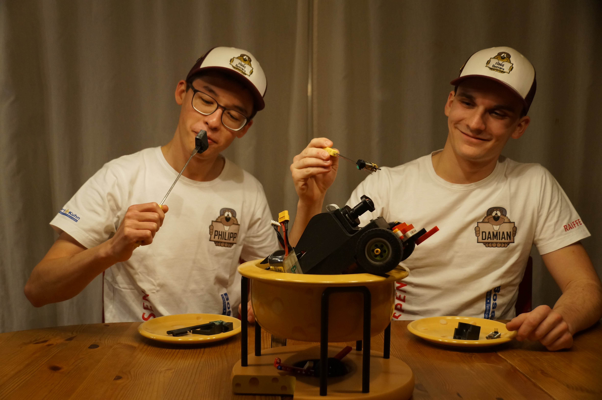

**Switzerland’s national dish is fondue—usually with cheese, but we prefer robot fondue! 😎🤪**
