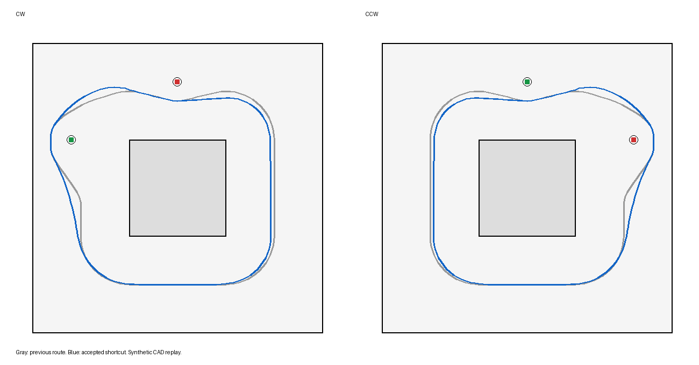

# Shorter continuous inner routes on laps 2/3, 2026-10-27

**Subsequent review:** the expanded actual-ramp matrix found six additional
reserve/acceleration failures caused by this optional refinement, plus one
pre-existing failure. The geometry and seven-scene results below remain bounded
observations, not a general dynamic acceptance. See
[FULL_CODE_REVIEW_20261027.md](FULL_CODE_REVIEW_20261027.md) for the complete
2191-case A/B comparison and preserved failing layouts. Subsequently addressed
by [RUNTIME_AND_ROUTE_FIXES_20261027.md](RUNTIME_AND_ROUTE_FIXES_20261027.md),
including 6573 actual-ramp cases at 10/20/50ms. Original review itself made no
firmware changes; physical acceptance of the corrected image remains pending.

The user requests fewer centre returns, direct diagonal corner approaches and
safe inner-band routes where the known passing sides allow them. Speed settings
must stay unchanged. This is an optional recorded-map refinement; it does not
change first-lap discovery, camera acquisition, start/exit geometry or parking.

## Implementation and acceptance

After the existing checked later-lap shape and smoothing, try inner-line targets
300/240/180/120 mm and a direct-join-only candidate. Straight and corner joins
can now connect different colours in this optional candidate. Discovery retains
the existing same-colour policy through default arguments. A solitary middle
in the next section may retain an inner lane independently of colour.

A symmetric five-point lateral relaxation connects known passing plateaus.
Outside passes retain their complete 150 mm plateaus and gradual transitions.
Inside passes may move farther away from the sign, without moving closer than
their checked passing offset. The 400 mm seam is protected and refinement fades
over the next 200 mm. This removes mandatory returns to the centre where they
are unnecessary. It is a bounded local search, not a globally shortest-path proof.

Every accepted candidate must:

- Shorten the checked route by at least 10 mm and reduce integrated target time
  by at least 0.01 s with the SAME speed planner/settings. Choose the fastest
  accepted candidate; an inward but slower route is rejected.
- Add no more than 0.01 rad to total absolute turning. Peak discrete curvature
  may not exceed the preceding peak or 1/250 per mm, whichever is greater;
  bending energy is also bounded. A tighter continuous radius can raise that
  energy without adding another S-bend; it is not a count of turns.
- Pass full body/wheel checks against parking pieces, complete field walls
  and every confirmed sign. Planned wall reserve is at least60 mm and retains
  the preceding minimum up to100 mm; planned pillar reserve is at least40 mm
  and retains the preceding minimum up to70 mm. These are additional distances
  outside the existing physical envelopes, not rear-axle-to-obstacle distances.
- Pass a complete CAD/integer-servo pursuit rollout at11.44 mm steps, from
  nominal and +/-10 mm lateral / +/-1 degree paired initial perturbations.
  This uses the runtime lookahead, corner multiplier and steering saturation.
  Require >=40 mm wall and >=30 mm pillar capsule reserve, 20 mm parking-piece
  body inflation, forward targets and correct whole-vehicle passing sides.

The actual old checked route remains the fallback. Cases where a direct bridge
would be longer, more winding or narrower are deliberately unchanged. In the
targeted example with an outer end sign and next outer entry sign, the search
retains the previous route; the next solitary-middle variant improves. Do not
describe every colour transition as automatically shortened.

## Computation and memory

Do not repeat the earlier blocking-geometry/gyro-resume regression. Cache normal
vectors, fades and inner-pass constraints outside the relaxation loops. Wall
geometry is computed once per pose; confirmed pillars use the identical capsule
distance directly. Existing rejection records are preserved. Against the frozen
`94b2e0d` exhaustive implementation,336 acceptance/rejection/minimum-clearance
comparisons pass.

The OPTIONAL search cooperatively checks a30,000 us budget, including its tracked
rollouts. At the deadline retain the best fully accepted candidate, or the old
checked shape. There is no added stop command or sensor acquisition. Individual
bounded operations between clock checks can add a small overrun; physical timing
is not measured. Four fake-clock/wrap cases confirm unchanged-route fallback.
Offline fixtures hold micros at zero to evaluate all candidates; onboard search
may finish fewer candidates. Inspect the existing new `[LAPS] Inner ... planning_us`
records in normal saved runs before claiming the offline gain on hardware.

Scratch arrays are static rather than additional large main-thread stack frames.
M7 RAM increases by8448 bytes; total442376/523624, leaving81248 bytes outside
static use. No M4 interface or consumer changes.

## Speed, force and deviation allowance

All speed/acceleration constants remain unchanged:520 mm/s maximum target,
0.8 m/s^2 lateral budget,10% speed and15% curvature allowances, existing finite
braking distance, motor acceleration/jerk and runtime curvature caps.

```
a_lateral = v^2 / R
F_lateral / mass = a_lateral
v_command <= sqrt(0.8 * R / 1.15) / 1.10       (metres, seconds)
```

The existing maximum budget is0.082 g or0.8 N/kg. In21 dynamic motor-ramp
rollouts at10/20/50 ms, highest modeled lateral acceleration is0.653264 m/s^2
and maximum speed520.813 mm/s. At the budget, a hypothetical uncompensated
0.2 s lateral interval gives0.5*0.8*0.2^2=0.016 m, or16 mm deviation. This
is an engineering allowance, NOT a measured upper bound on slip or servo lag.
The30/40 mm tracked pillar/wall reserves leave14/24 mm after that allowance;
the separate initial-pose perturbations are also exercised. Actual friction,
centre of gravity, estimator bias and sustained sliding remain unmeasured.

## Results versus the immediately preceding working candidate

Same speed constants and same dynamics planner on BOTH sides. The comparison
tool now detects an already-dynamic reference rather than comparing it to an
uncapped legacy profile by mistake. No hardware time claim.

- 2,807 two-lap CAD/layout cases PASS; minimum modeled wall/pillar reserves
  80.281/30.1851 mm. Tests witness complete body/wheel passing on both laps.
- Of2,191 uncapped cases,598 improve (295 CW,303 CCW). Among those: mean
  298.00 mm shorter/lap,7.64% lower target time and14.49% less bending energy.
  Across all uncapped cases, mean81.34 mm and2.09%; remaining cases keep the
  checked shape. Largest modeled saving1397.51 mm. Repeated-section and ordered
  adjacent-layout matrices are not exhaustive combinations of whole fields.
- A CW:7554.69 ->7149.42 mm, target16.8514 ->15.3370 s/lap. C CCW mirror:
  193.27 mm shorter and16.4590 ->14.9284 s. Several B/C examples are unchanged.
- Explicit outer end-sign -> next solitary-middle sign, CW and mirrored CCW:
  118.92 mm shorter and0.5467 s less target time/lap; absolute turn8.44865 ->
  8.04467 rad; modeled tracked pillar reserve66.84 ->74.77 mm (CW).
- Dynamic21 examples PASS; minimum dynamic pillar reserve32.2399 mm. These
  include actual extracted motor ramps but ideal CAD steering and no tyre slip.
- First-lap1,736 cases unchanged/PASS. Final parking396 complete sequences and
  five registration checks PASS. No new physical logs or original-log edits.



The picture shows the targeted solitary-middle case, not the unchanged next-entry
case. [Standalone SVG](INNER_LANE_ROUTE_COMPARISON_20261027.svg).

## Reproduction and physical next step

Run `check_later_laps.py`, `check_later_lap_inner_routes.py` and
`check_later_lap_dynamics.py` using IDE-managed Python. Generated fixtures,
comparisons and raw host outputs stay under ignored `local_workspace/`.
The targeted test compares optional refinement enabled/disabled, tests budget
fallback and frozen clearance equivalence, and regenerates the figure.

Canonical [rules PDF](https://wro-association.org/wp-content/uploads/WRO-2026-Future-Engineers-Self-Driving-Cars-General-Rules.pdf)
and [official Q&A](https://wro-association.org/competition/questions-answers/)
rechecked2026-10-27: PDF January15 edition/55 pages; latest listed parking-row
clarification October16. Retain RED-right/GREEN-left and every confirmed sign;
do not substitute inner-band preference for its required passing side.

User uploads M7 personally. Use normal complete CW/CCW runs and normal saving,
archive originals FIRST, then verify selected route, planning_us, real clearances
and lap timings. The four earlier missing CW logs remain pending. No dedicated
ToF sweep, extra movements, upload, commit or push by the agent.

Final IDE-managed incremental M7 build SUCCESS:RAM442376/523624,
flash522696/786432; firmware SHA-256
0c54fbeacb6da5ce114a365e98433e8a0a4ff90ba422da3055e989d6a6202e3c. M4 unaffected/not built. Existing project warnings remain.
